# 00 Overview

## Vision

UCSB CSSA runs on a mix of group chats, shared drives, and ad-hoc task lists. Information gets lost, onboarding new officers each year is painful, and leadership has no single place to see what each department is doing.

**CSSA Hub** is one internal web app where CSSA members:

- **talk** in department channels, group chats, and DMs (like GroupMe),
- **store and share** files and documents by department (like Google Drive),
- **assign and track** work with due dates and reviews (like Canvas assignments),
- and **get reminded** by email when something needs their attention.

## Users

- **系统管理员 (System Admin)**: the person who runs the app (the first account created). Full access to every page.
- **主席团 (Presidium)**: the top leadership (president, vice presidents). Super admins over the whole organization.
- **部长 (Department Lead)**: 1 to 2 leaders per department (e.g. 活动部, 国际部, 宣传部). Admins over their department.
- **部员 (Member)**: regular members of one or more departments.

Expected scale: tens to low hundreds of active accounts. Design for clarity over extreme scale.

## Goals

1. One login (`@ucsb.edu` Google account) for chat, files, and assignments.
2. Only approved CSSA members can get in. Every new account is reviewed by an admin.
3. Clear hierarchy: leadership can oversee the content of the people they manage, and **users are told this explicitly before their account is created**.
4. Chinese-first, bilingual UI (中文 default, English toggle).
5. Minimal, dark, fast UI that works well on laptops and phone browsers.
6. Email reminders for things that matter (approval, new assignments, due dates).
7. Easy yearly handover: department membership and leads can be changed without losing history.

## Non-goals (for now)

- Native mobile apps (web only; PWA may come later, see [roadmap](09-roadmap.md)).
- Public-facing pages, event ticketing, or payments.
- Video or voice calls.
- Real-time collaborative document editing like Google Docs (uploads only at first; see [open questions](10-open-questions.md)).
- End-to-end encryption. This conflicts with the oversight requirement by design.
- Grading or GPA-style scoring of assignments (approve / request changes only, unless decided otherwise).

## Glossary (术语表)

Use these terms consistently in code, UI, and docs.

| Chinese | English (UI) | Code identifier | Meaning |
| --- | --- | --- | --- |
| 系统管理员 | System Admin | `isSystemAdmin` | The first account created; full access to everything. Technical owner of the app |
| 组织架构 / 成员名册 | Roster | `roster` | Page showing the full hierarchy to every member |
| 预批准 | Pre-approval | `preApproval` | An email added to a department and role before the person signs in |
| 主席团 | Presidium | `presidium` | Top leadership, super admins. Modeled as a department with `kind: "presidium"` |
| 部门 | Department | `department` | An organizational unit, e.g. 活动部 |
| 部长 | Department Lead | `lead` | Admin of a department (membership role) |
| 部员 | Member | `member` | Regular member of a department (membership role) |
| 活动部 | Events Dept. | `events` (slug) | Example department |
| 国际部 | International Dept. | `international` (slug) | Example department |
| 宣传部 | Publicity Dept. | `publicity` (slug) | Example department |
| 频道 | Channel | `channel` | Any chat room: org-wide, department, group, or DM |
| 群聊 | Group chat | `channel` with `type: "group"` | Custom multi-person chat |
| 私信 | Direct message | `channel` with `type: "dm"` | One-on-one chat |
| 公告 | Announcement | `message` with `announcement: true` | Posted in 全体 by admins or in a department chat by its 部长; highlighted until each reader taps 知道了 |
| 文件 | Files | `file` / `folder` | Uploaded files and folder tree |
| 任务 | Task | `assignment` with `kind: "task"` | Work given to one or more people, posted in a chat |
| 活动 | Event | `assignment` with `kind: "event"` | An event (e.g. 春晚) with a time, place and helpers |
| 提交 | Submission | `assignmentSubmission` | An assignee's response to a task |
| 审批 | Approval | `status: "approved"` | Admin approval of a new account |
| 监督查看 | Oversight view | `oversight` | An admin reading content they are not a participant in |
| 审计日志 | Audit log | `auditLog` | Record of privileged actions |

## Product pillars at a glance

```mermaid
flowchart TB
  Hub[CSSA Hub]
  Hub --> Chat["Chat 聊天"]
  Hub --> Files["Files 文件"]
  Hub --> Assignments["Assignments 任务"]
  Hub --> Roster["Roster 组织架构"]
  Hub --> Admin["Admin 管理"]
  Roster --> Hierarchy[Hierarchy for everyone]
  Roster --> PreApprove[Pre-approve emails]
  Chat --> DeptChannels[Department channels]
  Chat --> Groups[Group chats]
  Chat --> DMs[Direct messages]
  Chat --> Announcements[Announcements]
  Files --> DeptFolders[Department spaces]
  Files --> OrgShared[公共 Public]
  Files --> Presidium[主席团 space]
  Assignments --> Events[Events with helpers]
  Assignments --> Assign[Assign and track]
  Assignments --> Submit[Submit and review]
  Roster --> Approvals[Account approvals]
  Roster --> DeptMgmt[Departments and leads]
  Admin --> Audit[Audit log]
  Admin --> Handover[Yearly handover]
```

