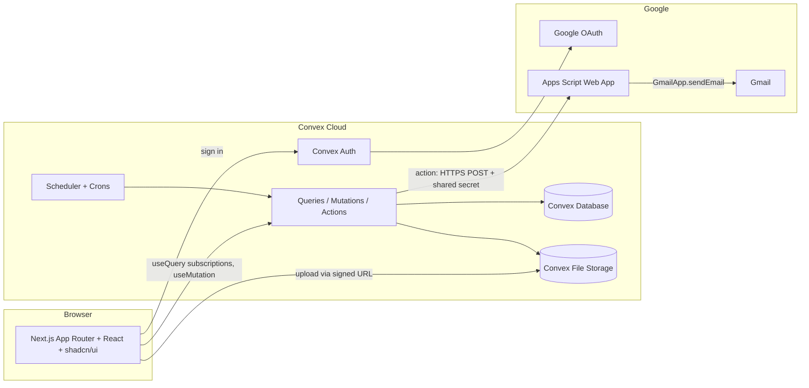
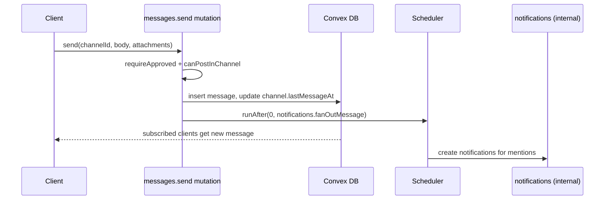
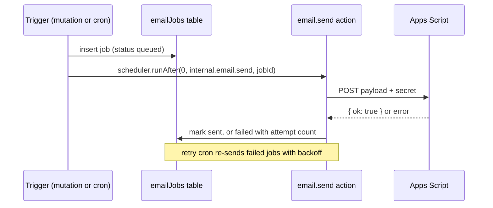

# 01 Architecture

## System diagram

### Why this shape

- **Convex** gives real-time subscriptions out of the box, which chat needs. It also covers the database, file storage, scheduled jobs, and server functions, so no separate backend server is required.
- **Next.js** hosts the UI only. It does not hold business logic. All reads and writes go through Convex functions, where permission checks run. It is built as a static export and served from GitHub Pages, so there is no Next.js server at runtime.
- **Google Apps Script** sends email from a CSSA Gmail account for free, without a paid email provider. Convex calls it over HTTPS. See [06-email-apps-script.md](06-email-apps-script.md).

## Frontend

### Route map

URLs have no locale segment; the language is a client-side setting (see [05-i18n.md](05-i18n.md)). Routes end with a trailing slash (`trailingSlash: true`) and are served under the base path (`/canvas` on GitHub Pages). Record IDs go in query parameters because a static export cannot prerender dynamic segments.

"Admin" means system admin or presidium (see [02-roles-and-permissions.md](02-roles-and-permissions.md#roles)).

| Route | Stage | Access | Purpose |
| --- | --- | --- | --- |
| `/` | 1 | anyone | Redirects to the page for the current account state |
| `/sign-in/` | 1 | signed out | Google sign-in button (`@ucsb.edu` only) |
| `/privacy/` | 1 | public (no gate) | Privacy policy, required by Google's OAuth consent screen |
| `/onboarding/` | 1 | signed in, status `new` or profile/consent incomplete | Names + oversight notice; shows pre-approved departments if any |
| `/pending/` | 1 | `status = "pending"` | "Waiting for approval" screen |
| `/rejected/` | 1 | `status = "rejected"` or `"deactivated"` | Explains access was denied or removed |
| `/chat/` | 1 | approved | Channel list; desktop opens the org channel by default |
| `/chat/?c=<channelId>` | 1 | approved, can read channel | Message view |
| `/roster/` | 1 | approved | Hierarchy for everyone; pending applicants, pre-approvals, and member management for admins and leads ([features/roster.md](features/roster.md)) |
| `/settings/` | 1 | approved | Profile, language, sign out, oversight notice |
| `/notifications/` | 2 | approved | Notification list |
| `/admin/` | 2 | lead or admin | Admin overview |
| `/admin/audit/` | 2 | admin | Audit log viewer |
| `/files/?f=<folderId>` | 3 | approved, can read folder | Files root, or a folder view |
| `/assignments/` | 3 | approved | "Assigned to me" and (for leads) "Assigned by me" |
| `/assignments/new/` | 3 | lead or admin | Create assignment |
| `/assignments/view/?a=<assignmentId>` | 3 | assignee, creator, or overseer | Detail, submission, review |

The system admin can open every route.

### Layout

- `frontend/app/(auth)/...`: centered card layout for sign-in, onboarding, pending, rejected, with the language toggle in the corner.
- `frontend/app/(app)/layout.tsx`: authenticated shell with a left sidebar and the main content area. The sidebar lists Chat, Notifications and Roster (Files and Assignments are disabled "coming soon" items); a "管理 Admin" group pinned to the bottom holds the admin overview (admins and 部长) and the audit log (admins only); Settings is a gear button next to the viewer's name in the footer. Below the `md` breakpoint the sidebar becomes a bottom tab bar with Chat, Notifications, Roster, Admin (when allowed) and Settings. See [04-design-system.md](04-design-system.md).
- Every page is wrapped in `AccountGate` (`frontend/components/auth/account-state.tsx`). It reads `useConvexAuth()` and `api.users.viewer`, works out the account state (`signedOut`, `onboarding`, `pending`, `rejected`, `app`), and redirects when the page doesn't match. Inside the gate, `useViewer()` returns the current user. The **server is still the authority**: every Convex function re-checks status and permissions.

### Static export constraints

The site is built with `output: "export"` and hosted on GitHub Pages, so:

- No `middleware.ts`, route handlers, server actions, `cookies()`, or `headers()`. Auth, locale, and redirects all happen in the browser.
- No dynamic route segments (`[id]`). Use query parameters read with `useSearchParams()`, inside a `<Suspense>` boundary.
- Auth uses the client-only `ConvexAuthProvider` from `@convex-dev/auth/react` (tokens in `localStorage`, namespace `cssa-hub`), not the Next.js server integration.
- Google OAuth returns to `SITE_URL` + `redirectTo`. Sign-in uses `redirectTo: "/sign-in/?from=google"`. If the account is rejected in the auth callback (for example, a non-`@ucsb.edu` email), Convex Auth redirects back without a session, and the sign-in page shows the domain error because `from=google` is present.
- `next/link` and `useRouter` add the base path automatically. Plain `<a href>` and asset URLs must not hard-code `/`.
- Images are unoptimized (`images.unoptimized: true`).

### State and data fetching

- Use Convex React hooks (`useQuery`, `useMutation`, `usePaginatedQuery`, `useAction`) directly in client components.
- No extra global state library at first. Local UI state uses React state; the URL query string holds the current channel or folder.
- Message lists use `usePaginatedQuery` with a "load older" button that keeps the scroll position.
- The frontend imports the API types from `@cssa-hub/backend/convex/_generated/api` and shared limits from `backend/convex/lib/constants.ts`, through `frontend/lib/api.ts`.

## Backend (Convex)

### Function layout

Paths are relative to `backend/`. Stage 1 implements everything up to `channels.ts` and `messages.ts` (list and send only).

| File | Responsibility |
| --- | --- |
| `convex/schema.ts` | Tables and indexes ([03-data-model.md](03-data-model.md)) |
| `convex/auth.ts`, `convex/auth.config.ts` | Convex Auth setup, Google provider, `@ucsb.edu` check |
| `convex/lib/permissions.ts` | `getViewer`, `requireApproved`, `requireAdmin`, `requireSystemAdmin`, etc. |
| `convex/lib/channels.ts` | `channelAccess`, `requireChannelAccess`, `oversees`, channel audiences |
| `convex/lib/audit.ts` | `logAudit(ctx, ...)` helper |
| `convex/users.ts` | Viewer, profile, onboarding submission (incl. first-admin and pre-approval claim), approval, deactivation, system admin grant |
| `convex/departments.ts` | Department create, rename, reorder |
| `convex/memberships.ts` | Add, remove, change role (department channel access follows automatically, see [03-data-model.md](03-data-model.md#channels-and-channelmembers)) |
| `convex/preApprovals.ts` | Create many, revoke |
| `convex/roster.ts` | Roster query (hierarchy + permission-filtered pending and pre-approvals) |
| `convex/seed.ts` | Idempotent seed of departments and default channels |
| `convex/channels.ts` | Channel list, create group or DM, membership, read state |
| `convex/messages.ts` | List (paginated), send, edit, delete, react |
| `convex/files.ts` | Upload URL, save metadata, list folder, rename, move, delete, download URL |
| `convex/folders.ts` | Folder tree CRUD |
| `convex/assignments.ts` | Create, update, list, submit, review |
| `convex/notifications.ts` | Create (internal), list, mark read |
| `convex/push.ts`, `convex/pushNode.ts`, `lib/push.ts`, `lib/pushText.ts` | Web Push: device subscriptions, VAPID config, scheduling, and the Node action that sends localized pushes (see [notifications-and-email.md](features/notifications-and-email.md#push-notifications)). Frontend side: `public/sw.js`, `app/manifest.ts`, `lib/push.ts` |
| `convex/email.ts` | Enqueue email job (internal mutation), send (internal action), retry |
| `convex/audit.ts` | Audit log queries (presidium only) |
| `convex/crons.ts` | Due-soon reminders, email retry, daily digest |
| `convex/http.ts` | Convex Auth HTTP routes |

Public functions are the only entry points from the client. Anything triggered by the system (notifications, email, crons) is an `internalMutation` or `internalAction`.

## Key data flows

### Sending a chat message

### Uploading a file

1. Client calls `files.generateUploadUrl` (mutation, permission checked for the target folder).
2. Client `POST`s the file directly to the returned Convex storage URL and receives a `storageId`.
3. Client calls `files.saveFile({ storageId, folderId, name, ... })`. The server re-checks permission, validates size and type, and inserts the `files` row.
4. Downloads use `files.getDownloadUrl`, which checks permission and returns `ctx.storage.getUrl(storageId)`.

Chat attachments use the same flow but attach to a message instead of a folder.

### Sending an email

### Assignment reminders

A Convex cron runs hourly. It finds assignments due in the next 24 hours where an assignee has not submitted and has not yet received a "due soon" reminder, then queues email and in-app notifications. See [features/assignments.md](features/assignments.md).

## Deployment

| Piece | Where |
| --- | --- |
| Next.js | Static export on GitHub Pages: `https://ucsb-cssa-dev.github.io/canvas/` |
| Convex | Convex Cloud (dev and prod deployments) |
| Apps Script | Deployed as a web app under the CSSA Google account (Stage 3) |

Environments: `dev` (each developer's Convex dev deployment) and `prod`. Environment variables are listed in [07-security-and-privacy.md](07-security-and-privacy.md#secrets-and-environment-variables).

### GitHub Actions

| Workflow | Trigger | Steps |
| --- | --- | --- |
| `.github/workflows/ci.yml` | pull requests, pushes to branches other than `main`, and called by deploy | `npm ci`, lint, typecheck, backend tests, i18n key check, static build with a placeholder Convex URL |
| `.github/workflows/deploy.yml` | push to `main`, manual | Runs CI, then `npx convex deploy --cmd 'npm run build --prefix ../frontend'` (deploys Convex and builds the site with `NEXT_PUBLIC_CONVEX_URL` set to the prod URL and `NEXT_PUBLIC_BASE_PATH` from `actions/configure-pages`), uploads `frontend/out`, publishes with `actions/deploy-pages` |

Required: the `CONVEX_DEPLOY_KEY` repository secret, and Pages source set to "GitHub Actions". Setup steps are in the [README](../README.md#deployment-github-pages--convex).
