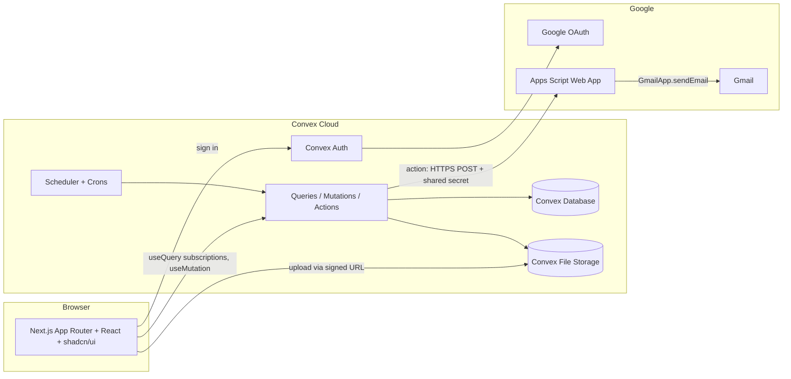
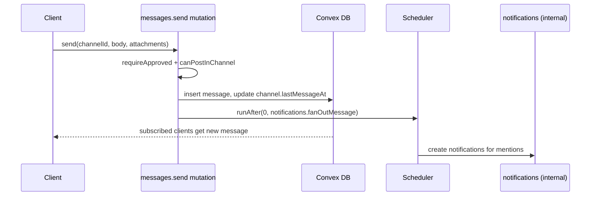
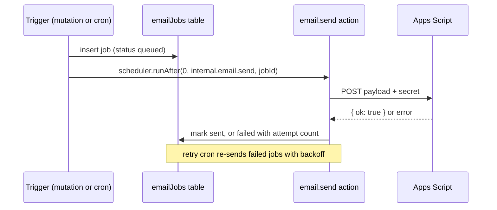

# 01 Architecture

## System diagram

### Why this shape

- **Convex** gives real-time subscriptions out of the box, which chat needs. It also covers the database, file storage, scheduled jobs, and server functions, so no separate backend server is required.
- **Next.js** hosts the UI only. It does not hold business logic. All reads and writes go through Convex functions, where permission checks run.
- **Google Apps Script** sends email from a CSSA Gmail account for free, without a paid email provider. Convex calls it over HTTPS. See [06-email-apps-script.md](06-email-apps-script.md).

## Frontend

### Route map

All routes sit under a locale segment (`zh` default, `en`). See [05-i18n.md](05-i18n.md).

"Admin" means system admin or presidium (see [02-roles-and-permissions.md](02-roles-and-permissions.md#roles)).

| Route | Stage | Access | Purpose |
| --- | --- | --- | --- |
| `/[locale]/sign-in` | 1 | public | Google sign-in button (`@ucsb.edu` only) |
| `/[locale]/onboarding` | 1 | signed in, profile or consent incomplete | Names + oversight notice; shows pre-approved departments if any |
| `/[locale]/pending` | 1 | `status = "pending"` | "Waiting for approval" screen |
| `/[locale]/rejected` | 1 | `status = "rejected"` or `"deactivated"` | Explains access was denied or removed |
| `/[locale]/chat` | 1 | approved | Channel list + last opened channel |
| `/[locale]/chat/[channelId]` | 1 | approved, can read channel | Message view |
| `/[locale]/roster` | 1 | approved | Hierarchy for everyone; pending applicants, pre-approvals, and member management for admins and leads ([features/roster.md](features/roster.md)) |
| `/[locale]/settings` | 1 | approved | Profile and language (more settings in later stages) |
| `/[locale]/notifications` | 2 | approved | Notification list |
| `/[locale]/admin` | 2 | lead or admin | Admin overview |
| `/[locale]/admin/audit` | 2 | admin | Audit log viewer |
| `/[locale]/files` | 3 | approved | Root of files (department, shared, my files) |
| `/[locale]/files/[folderId]` | 3 | approved, can read folder | Folder view |
| `/[locale]/assignments` | 3 | approved | "Assigned to me" and (for leads) "Assigned by me" |
| `/[locale]/assignments/new` | 3 | lead or admin | Create assignment |
| `/[locale]/assignments/[assignmentId]` | 3 | assignee, creator, or overseer | Detail, submission, review |

The system admin can open every route.

### Layout

- `app/[locale]/(auth)/...`: centered card layout for sign-in, onboarding, pending, rejected.
- `app/[locale]/(app)/layout.tsx`: authenticated shell with a left sidebar (Stage 1: Chat, Roster, Settings, with Files and Assignments shown as disabled "coming soon" items; later: Notifications, Admin when allowed) and the main content area. On narrow screens the sidebar becomes a bottom tab bar or sheet. See [04-design-system.md](04-design-system.md).
- A client-side gate component reads `api.users.viewer` and redirects based on `status`. The **server is still the authority**: every Convex function re-checks status and permissions.

### Middleware

Two middlewares must be composed in `middleware.ts`:

1. `next-intl` middleware for locale detection and prefixing.
2. Convex Auth Next.js middleware (`convexAuthNextjsMiddleware`) to protect `(app)` routes and redirect unauthenticated users to `/[locale]/sign-in`.

### State and data fetching

- Use Convex React hooks (`useQuery`, `useMutation`, `usePaginatedQuery`, `useAction`) directly in client components.
- No extra global state library at first. Local UI state uses React state; URL holds the current channel or folder.
- Message lists use `usePaginatedQuery` and load older messages on scroll up.

## Backend (Convex)

### Function layout

| File | Responsibility |
| --- | --- |
| `convex/schema.ts` | Tables and indexes ([03-data-model.md](03-data-model.md)) |
| `convex/auth.ts`, `convex/auth.config.ts` | Convex Auth setup, Google provider, `@ucsb.edu` check |
| `convex/lib/permissions.ts` | `getViewer`, `requireApproved`, `requireAdmin`, `requireSystemAdmin`, `canReadChannel`, `oversees`, etc. |
| `convex/lib/audit.ts` | `logAudit(ctx, ...)` helper |
| `convex/users.ts` | Viewer, profile, onboarding submission (incl. first-admin and pre-approval claim), approval, deactivation, system admin grant |
| `convex/departments.ts` | Department create, rename, reorder |
| `convex/memberships.ts` | Add, remove, change role; keeps department channel membership in sync |
| `convex/preApprovals.ts` | Create many, revoke |
| `convex/roster.ts` | Roster query (hierarchy + permission-filtered pending and pre-approvals) |
| `convex/seed.ts` | Idempotent seed of departments and default channels |
| `convex/channels.ts` | Channel list, create group or DM, membership, read state |
| `convex/messages.ts` | List (paginated), send, edit, delete, react |
| `convex/files.ts` | Upload URL, save metadata, list folder, rename, move, delete, download URL |
| `convex/folders.ts` | Folder tree CRUD |
| `convex/assignments.ts` | Create, update, list, submit, review |
| `convex/notifications.ts` | Create (internal), list, mark read |
| `convex/email.ts` | Enqueue email job (internal mutation), send (internal action), retry |
| `convex/audit.ts` | Audit log queries (presidium only) |
| `convex/crons.ts` | Due-soon reminders, email retry, daily digest |
| `convex/http.ts` | Convex Auth HTTP routes |

Public functions are the only entry points from the client. Anything triggered by the system (notifications, email, crons) is an `internalMutation` or `internalAction`.

## Key data flows

### Sending a chat message

### Uploading a file

1. Client calls `files.generateUploadUrl` (mutation, permission checked for the target folder).
2. Client `POST`s the file directly to the returned Convex storage URL and receives a `storageId`.
3. Client calls `files.saveFile({ storageId, folderId, name, ... })`. The server re-checks permission, validates size and type, and inserts the `files` row.
4. Downloads use `files.getDownloadUrl`, which checks permission and returns `ctx.storage.getUrl(storageId)`.

Chat attachments use the same flow but attach to a message instead of a folder.

### Sending an email

### Assignment reminders

A Convex cron runs hourly. It finds assignments due in the next 24 hours where an assignee has not submitted and has not yet received a "due soon" reminder, then queues email and in-app notifications. See [features/assignments.md](features/assignments.md).

## Deployment

| Piece | Where |
| --- | --- |
| Next.js | Vercel (recommended) or any Node host |
| Convex | Convex Cloud (dev and prod deployments) |
| Apps Script | Deployed as a web app under the CSSA Google account |

Environments: `dev` (each developer's Convex dev deployment) and `prod`. Environment variables are listed in [07-security-and-privacy.md](07-security-and-privacy.md#secrets-and-environment-variables).
