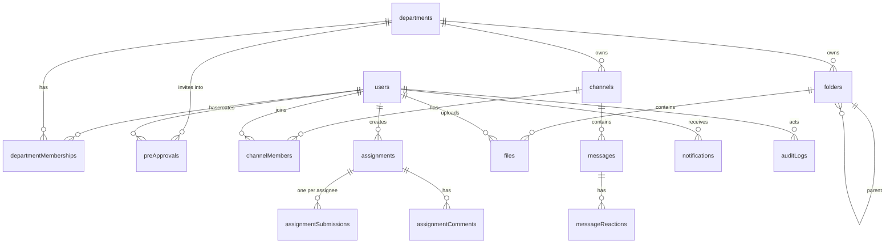

# 03 Data Model (Convex Schema Draft)

This is the target `convex/schema.ts`. It is a draft: field names and indexes may be refined during implementation, but **any change must be reflected here**.

Conventions:

- Every Convex document has `_id` and `_creationTime` automatically. Don't add `createdAt` unless a different time is needed.
- Timestamps are `number` (ms since epoch).
- Soft delete uses `deletedAt?: number`. Queries must filter out soft-deleted rows unless the caller is presidium reviewing them.
- Bilingual display data uses `nameZh` / `nameEn` pairs (see [05-i18n.md](05-i18n.md)).

## Tables by stage

Only create the tables for the current stage (see [09-roadmap.md](09-roadmap.md)); later tables are added when their stage starts.

| Stage | Tables |
| --- | --- |
| 1 | `users` (+ Convex Auth tables), `departments`, `departmentMemberships`, `preApprovals`, `channels`, `channelMembers`, `messages`, `auditLogs` |
| 2 | `messageReactions`, `notifications` |
| 3 | `folders`, `files`, `assignments`, `assignmentSubmissions`, `assignmentComments`, `emailJobs` |
| 4 | TBA (likely embedding tables with vector indexes for AI features) |

In Stage 1, `channels.type` only uses `"org"`, `"department"`, and `"dm"`, and `messages.attachments` / `mentionUserIds` stay empty arrays.

## Entity relationships



## Schema

```ts
import { defineSchema, defineTable } from "convex/server";
import { v } from "convex/values";
import { authTables } from "@convex-dev/auth/server";

const attachment = v.object({
  storageId: v.id("_storage"),
  name: v.string(),
  contentType: v.string(),
  size: v.number(),
});

export default defineSchema({
  ...authTables, // Convex Auth tables; `users` is overridden below

  // ---------- Accounts ----------
  users: defineTable({
    // Fields managed by Convex Auth (keep them optional as Convex Auth expects)
    name: v.optional(v.string()),
    image: v.optional(v.string()),
    email: v.optional(v.string()),
    emailVerificationTime: v.optional(v.number()),
    isAnonymous: v.optional(v.boolean()),

    // App fields
    isSystemAdmin: v.optional(v.boolean()),   // first account; see 02-roles-and-permissions.md
    status: v.optional(v.union(
      v.literal("new"),          // signed in, onboarding not submitted
      v.literal("pending"),      // submitted, waiting for approval
      v.literal("approved"),
      v.literal("rejected"),
      v.literal("deactivated"),
    )),
    nameZh: v.optional(v.string()),           // 中文名
    nameEn: v.optional(v.string()),           // English name
    wechatId: v.optional(v.string()),
    major: v.optional(v.string()),
    graduationYear: v.optional(v.number()),
    requestedDepartmentIds: v.optional(v.array(v.id("departments"))), // chosen at onboarding
    applicationNote: v.optional(v.string()),
    oversightConsentAt: v.optional(v.number()),
    oversightConsentVersion: v.optional(v.number()),
    reviewedBy: v.optional(v.id("users")),
    reviewedAt: v.optional(v.number()),
    rejectionReason: v.optional(v.string()),
    locale: v.optional(v.union(v.literal("zh"), v.literal("en"))),
    emailPrefs: v.optional(v.object({
      assignments: v.boolean(),     // new assignment + due-soon reminders
      mentions: v.boolean(),        // @mention digest
      announcements: v.boolean(),
    })),
    lastSeenAt: v.optional(v.number()),
  })
    .index("email", ["email"])           // required by Convex Auth
    .index("by_status", ["status"])
    .index("by_isSystemAdmin", ["isSystemAdmin"]),

  // Emails placed into the hierarchy before the person signs in.
  // One row per (email, department). Claimed on first sign-in / onboarding.
  preApprovals: defineTable({
    email: v.string(),                   // lowercased, must end with @ucsb.edu
    departmentId: v.id("departments"),
    role: v.union(v.literal("lead"), v.literal("member")),
    note: v.optional(v.string()),        // e.g. "2026 秋季新部员"
    createdBy: v.id("users"),
    claimedAt: v.optional(v.number()),
    claimedBy: v.optional(v.id("users")),
    revokedAt: v.optional(v.number()),
    revokedBy: v.optional(v.id("users")),
  })
    .index("by_email", ["email"])
    .index("by_department", ["departmentId"])
    .index("by_email_department", ["email", "departmentId"]),

  // ---------- Organization ----------
  departments: defineTable({
    slug: v.string(),                    // "events", "international", "publicity", "presidium"
    nameZh: v.string(),                  // "活动部"
    nameEn: v.string(),                  // "Events"
    kind: v.union(v.literal("presidium"), v.literal("regular")),
    descriptionZh: v.optional(v.string()),
    descriptionEn: v.optional(v.string()),
    sortOrder: v.number(),
    archivedAt: v.optional(v.number()),
  })
    .index("by_slug", ["slug"])
    .index("by_kind", ["kind"]),

  departmentMemberships: defineTable({
    userId: v.id("users"),
    departmentId: v.id("departments"),
    role: v.union(v.literal("lead"), v.literal("member")),
    addedBy: v.id("users"),
  })
    .index("by_user", ["userId"])
    .index("by_department", ["departmentId"])
    .index("by_department_role", ["departmentId", "role"])
    .index("by_user_department", ["userId", "departmentId"]),

  // ---------- Chat ----------
  channels: defineTable({
    type: v.union(
      v.literal("org"),            // org-wide general channel
      v.literal("department"),     // one per department, auto-membership
      v.literal("announcement"),   // org-wide (departmentId unset) or per department
      v.literal("group"),          // user-created group chat
      v.literal("dm"),             // exactly two members
    ),
    name: v.optional(v.string()),            // group chats; others derive name
    departmentId: v.optional(v.id("departments")),
    dmKey: v.optional(v.string()),           // sorted "userIdA:userIdB" for DM uniqueness
    createdBy: v.id("users"),
    lastMessageAt: v.optional(v.number()),
    archivedAt: v.optional(v.number()),
  })
    .index("by_type", ["type"])
    .index("by_department", ["departmentId"])
    .index("by_dmKey", ["dmKey"]),

  channelMembers: defineTable({
    channelId: v.id("channels"),
    userId: v.id("users"),
    role: v.union(v.literal("admin"), v.literal("member")), // group chat admin
    lastReadAt: v.number(),
    muted: v.boolean(),
  })
    .index("by_channel", ["channelId"])
    .index("by_user", ["userId"])
    .index("by_channel_user", ["channelId", "userId"]),

  messages: defineTable({
    channelId: v.id("channels"),
    authorId: v.id("users"),
    body: v.string(),                        // plain text with lightweight markdown
    attachments: v.array(attachment),
    mentionUserIds: v.array(v.id("users")),
    replyToId: v.optional(v.id("messages")),
    editedAt: v.optional(v.number()),
    deletedAt: v.optional(v.number()),
    deletedBy: v.optional(v.id("users")),
  })
    .index("by_channel", ["channelId"])                 // ordered by _creationTime
    .index("by_author", ["authorId"])
    .searchIndex("search_body", { searchField: "body", filterFields: ["channelId"] }),

  messageReactions: defineTable({
    messageId: v.id("messages"),
    userId: v.id("users"),
    emoji: v.string(),
  })
    .index("by_message", ["messageId"])
    .index("by_message_user_emoji", ["messageId", "userId", "emoji"]),

  // ---------- Files ----------
  folders: defineTable({
    name: v.string(),
    scope: v.union(v.literal("org"), v.literal("department"), v.literal("personal")),
    departmentId: v.optional(v.id("departments")), // scope = department
    ownerId: v.optional(v.id("users")),            // scope = personal
    parentId: v.optional(v.id("folders")),         // undefined = root of its scope
    createdBy: v.id("users"),
    deletedAt: v.optional(v.number()),
  })
    .index("by_parent", ["parentId"])
    .index("by_scope_department", ["scope", "departmentId"])
    .index("by_scope_owner", ["scope", "ownerId"]),

  files: defineTable({
    storageId: v.id("_storage"),
    name: v.string(),
    contentType: v.string(),
    size: v.number(),
    folderId: v.id("folders"),
    // denormalized from folder for fast permission checks
    scope: v.union(v.literal("org"), v.literal("department"), v.literal("personal")),
    departmentId: v.optional(v.id("departments")),
    uploadedBy: v.id("users"),
    description: v.optional(v.string()),
    deletedAt: v.optional(v.number()),
  })
    .index("by_folder", ["folderId"])
    .index("by_uploader", ["uploadedBy"])
    .searchIndex("search_name", { searchField: "name", filterFields: ["scope", "departmentId"] }),

  // ---------- Assignments ----------
  assignments: defineTable({
    title: v.string(),
    description: v.string(),                 // markdown
    createdBy: v.id("users"),
    departmentId: v.optional(v.id("departments")), // the department this work is for
    dueAt: v.optional(v.number()),
    status: v.union(v.literal("draft"), v.literal("open"), v.literal("closed")),
    requiresSubmission: v.boolean(),         // false = just "mark done"
    attachments: v.array(attachment),
    publishedAt: v.optional(v.number()),
    closedAt: v.optional(v.number()),
  })
    .index("by_creator", ["createdBy"])
    .index("by_department", ["departmentId"])
    .index("by_status_due", ["status", "dueAt"]),

  // One row per assignee, created when the assignment is published.
  assignmentSubmissions: defineTable({
    assignmentId: v.id("assignments"),
    assigneeId: v.id("users"),
    status: v.union(
      v.literal("assigned"),
      v.literal("in_progress"),
      v.literal("submitted"),
      v.literal("changes_requested"),
      v.literal("approved"),
    ),
    text: v.optional(v.string()),
    attachments: v.array(attachment),
    link: v.optional(v.string()),
    submittedAt: v.optional(v.number()),
    reviewedBy: v.optional(v.id("users")),
    reviewedAt: v.optional(v.number()),
    dueSoonReminderSentAt: v.optional(v.number()),
    overdueReminderSentAt: v.optional(v.number()),
  })
    .index("by_assignment", ["assignmentId"])
    .index("by_assignee", ["assigneeId"])
    .index("by_assignee_status", ["assigneeId", "status"])
    .index("by_assignment_assignee", ["assignmentId", "assigneeId"]),

  // Feedback thread on a specific submission
  assignmentComments: defineTable({
    submissionId: v.id("assignmentSubmissions"),
    authorId: v.id("users"),
    body: v.string(),
  }).index("by_submission", ["submissionId"]),

  // ---------- Notifications and email ----------
  notifications: defineTable({
    userId: v.id("users"),
    type: v.union(
      v.literal("account_approved"),
      v.literal("account_rejected"),
      v.literal("mention"),
      v.literal("assignment_new"),
      v.literal("assignment_due_soon"),
      v.literal("assignment_overdue"),
      v.literal("submission_received"),
      v.literal("submission_reviewed"),
      v.literal("added_to_department"),
      v.literal("announcement"),
    ),
    params: v.any(),                  // values interpolated into the translated message
    link: v.optional(v.string()),     // in-app path without locale, e.g. "/assignments/abc"
    readAt: v.optional(v.number()),
  })
    .index("by_user", ["userId"])
    .index("by_user_read", ["userId", "readAt"]),

  emailJobs: defineTable({
    to: v.string(),
    userId: v.optional(v.id("users")),
    template: v.string(),             // see 06-email-apps-script.md
    locale: v.union(v.literal("zh"), v.literal("en")),
    params: v.any(),
    status: v.union(v.literal("queued"), v.literal("sending"), v.literal("sent"), v.literal("failed")),
    attempts: v.number(),
    lastError: v.optional(v.string()),
    sendAfter: v.number(),
    sentAt: v.optional(v.number()),
    dedupeKey: v.optional(v.string()), // e.g. "due_soon:<submissionId>"
  })
    .index("by_status_sendAfter", ["status", "sendAfter"])
    .index("by_dedupeKey", ["dedupeKey"]),

  // ---------- Audit ----------
  auditLogs: defineTable({
    actorId: v.id("users"),
    action: v.string(),               // e.g. "user.approve", "oversight.channel.open"
    targetType: v.string(),           // "user" | "channel" | "file" | "submission" | "department" | "message"
    targetId: v.string(),
    subjectUserId: v.optional(v.id("users")), // whose content was accessed, if any
    metadata: v.optional(v.any()),
  })
    .index("by_actor", ["actorId"])
    .index("by_subject", ["subjectUserId"])
    .index("by_action", ["action"]),
});
```

## Table notes

### users

- Created by Convex Auth on first Google sign-in. A `createOrUpdateUser` callback (or `afterUserCreatedOrUpdated`) sets `status = "new"` and default `locale = "zh"` and `emailPrefs`.
- The `@ucsb.edu` domain check happens in the auth callback, **before** a user row is created. See [features/accounts-and-onboarding.md](features/accounts-and-onboarding.md).
- Display name: `nameZh` when locale is `zh` and it exists, otherwise `nameEn`, otherwise `name` from Google.

### preApprovals

- Created from the roster page by admins and leads (see [features/roster.md](features/roster.md#pre-approving-emails)).
- "Active" = `claimedAt`, `revokedAt` both unset. At most one active row per `(email, departmentId)`; pre-approving the same email and department again updates the role instead of inserting.
- Claimed in the same mutation that approves the user and creates the `departmentMemberships` rows. See [features/accounts-and-onboarding.md](features/accounts-and-onboarding.md#pre-approved-emails).
- If the email already belongs to an **approved** user, the membership is applied immediately and the row is marked claimed at creation time.
- Kept after claiming as a record of who invited whom.

### departments

- Seeded: 主席团 (`presidium`, kind `presidium`), plus regular departments such as 活动部 (`events`), 国际部 (`international`), 宣传部 (`publicity`). The full list is configurable by presidium.
- Creating a department also creates its `department` channel, a department `announcement` channel, and a root department folder.

### departmentMemberships

- Adding a membership also adds a `channelMembers` row for the department channel and announcement channel. Removing a membership removes those rows. Do both in the **same mutation**.

### channels and channelMembers

- `dm` channels are unique per pair via `dmKey` (sorted user IDs joined with `:`).
- Unread count = messages in channel with `_creationTime > channelMembers.lastReadAt` (cap the count at 99 when displaying).
- Oversight readers are **not** added to `channelMembers`.

### messages

- Soft delete keeps the row: `deletedAt` and `deletedBy` are set and normal viewers see "消息已删除 / Message deleted". Whether the original body is kept for presidium is an [open question](10-open-questions.md).
- Paginate with `.withIndex("by_channel", q => q.eq("channelId", id)).order("desc").paginate(opts)`.

### folders and files

- Root folders: one `org` root, one root per department, and one `personal` root per user, created lazily.
- `files.scope` and `files.departmentId` are copied from the folder and updated when a file moves.

### assignments and assignmentSubmissions

- Assigning to a whole department expands to individual `assignmentSubmissions` rows at publish time. Members who join later are not added automatically, but a lead can add them.
- Assignment `status` is the creator's control (open or closed). Per-person progress lives in `assignmentSubmissions.status`.

### auditLogs

- Append-only. No update or delete functions are exposed.

## Seed data (`convex/seed.ts`, internal)

1. Create departments: presidium, events, international, publicity (the rest are added from the roster page), each with its department channel.
2. Create the `org` general channel. From Stage 2 on: the org-wide announcement channel. From Stage 3 on: the org root folder.
3. The seed is idempotent (safe to run twice) and runs automatically when the first user is created if no departments exist yet.

There is no manual admin bootstrap step: the first account to sign in becomes system admin. See [features/accounts-and-onboarding.md](features/accounts-and-onboarding.md#first-account-becomes-system-admin).
