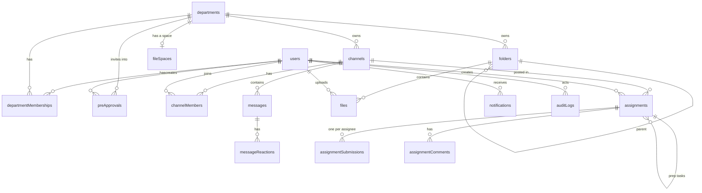

# 03 Data Model (Convex Schema Draft)

This is the target `backend/convex/schema.ts` for all stages. It is a draft: field names and indexes may be refined during implementation, but **any change must be reflected here**. For what is deployed today, `backend/convex/schema.ts` is authoritative.

Conventions:

- Every Convex document has `_id` and `_creationTime` automatically. Don't add `createdAt` unless a different time is needed.
- Timestamps are `number` (ms since epoch).
- Soft delete uses `deletedAt?: number`. Queries must filter out soft-deleted rows unless the caller is presidium reviewing them.
- Bilingual display data uses `nameZh` / `nameEn` pairs (see [05-i18n.md](05-i18n.md)).

## Tables by stage

Only create the tables for the current stage (see [09-roadmap.md](09-roadmap.md)); later tables are added when their stage starts.

| Stage | Tables |
| --- | --- |
| 1 | `users` (+ Convex Auth tables), `departments`, `departmentMemberships`, `formerPresidium`, `deactivationRequests`, `preApprovals`, `channels`, `channelMembers`, `messages`, `auditLogs` |
| 2 | `groupDepartments`, `groupProposals`, `messageEdits`, `messageReactions`, `attachments`, `chatApps`, `chatAppResponses`, `notifications`, `pushSubscriptions` |
| 3 | `fileSpaces`, `folders`, `files`, `driveUploads`, `documents` (+ the `prosemirrorSync` component), `assignments`, `assignmentSubmissions`, `assignmentComments`, `emailJobs` (+ `users.digestEmail`, `messages.assignmentId` and `messages.fileIds`) |
| 4 | TBA (likely embedding tables with vector indexes for AI features) |

The chat tables below match what Stage 2 deployed. Notes:

- Stage 2 fields on `channels`, `channelMembers`, and `messages` are optional so Stage 1 rows stay valid. `channels.createdBy` is optional because seeded channels have no creator.
- Departments are archived with `departments.archivedAt`; channels have no archive flag of their own (an archived department makes its channels read-only).
- `departmentMemberships.addedBy` and `auditLogs.actorId` are optional so the seed and system events can write rows.

## Entity relationships



## Schema

```ts
import { defineSchema, defineTable } from "convex/server";
import { v } from "convex/values";
import { authTables } from "@convex-dev/auth/server";

export default defineSchema({
  ...authTables, // Convex Auth tables; `users` is overridden below

  // ---------- Accounts ----------
  users: defineTable({
    // Fields managed by Convex Auth (keep them optional as Convex Auth expects)
    name: v.optional(v.string()),
    image: v.optional(v.string()),
    email: v.optional(v.string()),
    emailVerificationTime: v.optional(v.number()),
    isAnonymous: v.optional(v.boolean()),

    // App fields
    isSystemAdmin: v.optional(v.boolean()),   // first account; see 02-roles-and-permissions.md
    status: v.optional(v.union(
      v.literal("new"),          // signed in, onboarding not submitted
      v.literal("pending"),      // submitted, waiting for approval
      v.literal("approved"),
      v.literal("rejected"),
      v.literal("deactivated"),
    )),
    nameZh: v.optional(v.string()),           // 中文名
    nameEn: v.optional(v.string()),           // English name
    bio: v.optional(v.string()),              // public, max 160 chars
    avatarStorageId: v.optional(v.id("_storage")), // uploaded photo (256px JPEG)
    avatarUrl: v.optional(v.string()),        // overrides the Google `image`, which sign-in rewrites
    wechatId: v.optional(v.string()),
    major: v.optional(v.string()),
    graduationYear: v.optional(v.number()),
    requestedDepartmentIds: v.optional(v.array(v.id("departments"))), // chosen at onboarding
    applicationNote: v.optional(v.string()),
    oversightConsentAt: v.optional(v.number()),
    oversightConsentVersion: v.optional(v.number()),
    reviewedBy: v.optional(v.id("users")),
    reviewedAt: v.optional(v.number()),
    rejectionReason: v.optional(v.string()),
    locale: v.optional(v.union(v.literal("zh"), v.literal("en"))),
    digestEmail: v.optional(v.string()), // daily digest address; unset = sign-in email (Stage 3)
    lastSeenAt: v.optional(v.number()),
  })
    .index("email", ["email"])           // required by Convex Auth
    .index("by_status", ["status"])
    .index("by_isSystemAdmin", ["isSystemAdmin"]),

  // Emails placed into the hierarchy before the person signs in.
  // One row per (email, department). Claimed on first sign-in / onboarding.
  preApprovals: defineTable({
    email: v.string(),                   // lowercased, must end with @ucsb.edu
    departmentId: v.id("departments"),
    role: v.union(v.literal("lead"), v.literal("member")),
    note: v.optional(v.string()),        // e.g. "2026 秋季新部员"
    createdBy: v.id("users"),
    claimedAt: v.optional(v.number()),
    claimedBy: v.optional(v.id("users")),
    revokedAt: v.optional(v.number()),
    revokedBy: v.optional(v.id("users")),
  })
    .index("by_email", ["email"])
    .index("by_department", ["departmentId"])
    .index("by_email_department", ["email", "departmentId"]),

  // ---------- Organization ----------
  departments: defineTable({
    slug: v.string(),                    // "events", "international", "publicity", "presidium"
    nameZh: v.string(),                  // "活动部"
    nameEn: v.string(),                  // "Events"
    kind: v.union(v.literal("presidium"), v.literal("regular")),
    descriptionZh: v.optional(v.string()),
    descriptionEn: v.optional(v.string()),
    sortOrder: v.number(),
    archivedAt: v.optional(v.number()),
  })
    .index("by_slug", ["slug"])
    .index("by_kind", ["kind"]),

  departmentMemberships: defineTable({
    userId: v.id("users"),
    departmentId: v.id("departments"),
    // In 主席团: "lead" = 主席, "member" = 副主席. Elsewhere: 部长 / 部员.
    role: v.union(v.literal("lead"), v.literal("member")),
    addedBy: v.id("users"),
    wasChair: v.optional(v.boolean()),   // 主席团 only: was 主席 earlier this term
  })
    .index("by_user", ["userId"])
    .index("by_department", ["departmentId"])
    .index("by_department_role", ["departmentId", "role"])
    .index("by_user_department", ["userId", "departmentId"]),

  // 前主席 / 前副主席: people who retired from 主席团.
  formerPresidium: defineTable({
    userId: v.id("users"),
    role: v.union(v.literal("lead"), v.literal("member")),  // "lead" = 前主席
    retiredAt: v.number(),
  }).index("by_user", ["userId"]),

  // ---------- Chat (deployed in Stage 2) ----------
  channels: defineTable({
    type: v.union(
      v.literal("org"),            // org-wide general channel
      v.literal("announcement"),   // legacy, merged into org/department chats (see below)
      v.literal("department"),     // one per department, access derived from memberships
      v.literal("group"),          // group chat belonging to departments
      v.literal("dm"),             // exactly two members
    ),
    name: v.optional(v.string()),            // group chats; others derive their name
    departmentId: v.optional(v.id("departments")),
    dmKey: v.optional(v.string()),           // sorted "userIdA:userIdB" for DM uniqueness
    createdBy: v.optional(v.id("users")),
    lastMessageAt: v.optional(v.number()),
    retentionDays: v.optional(v.number()),   // unset = 15
    purpose: v.optional(v.string()),         // groups
    proposalId: v.optional(v.id("groupProposals")),
    endedAt: v.optional(v.number()),         // groups: read-only once set
  })
    .index("by_type", ["type"])
    .index("by_department", ["departmentId"])
    .index("by_dmKey", ["dmKey"]),

  // Departments involved in a group; their 部长 are members automatically.
  groupDepartments: defineTable({
    channelId: v.id("channels"),
    departmentId: v.id("departments"),
  })
    .index("by_channel", ["channelId"])
    .index("by_department", ["departmentId"]),

  groupProposals: defineTable({
    proposerId: v.id("users"),
    name: v.string(),
    purpose: v.string(),
    departmentIds: v.array(v.id("departments")),
    suggestedUserIds: v.array(v.id("users")),
    status: v.union(
      v.literal("pending"), v.literal("approved"), v.literal("rejected"),
      v.literal("cancelled"), v.literal("expired"),
    ),
    reviewedBy: v.optional(v.id("users")),
    reviewedAt: v.optional(v.number()),
    reviewNote: v.optional(v.string()),
    channelId: v.optional(v.id("channels")),
    expiresAt: v.number(),
  })
    .index("by_proposer", ["proposerId"])
    .index("by_status", ["status"]),

  channelMembers: defineTable({
    channelId: v.id("channels"),
    userId: v.id("users"),
    lastReadAt: v.number(),
    announcementsReadAt: v.optional(v.number()), // announcements acknowledged ("知道了") up to here
    muted: v.optional(v.boolean()),
    joinedAt: v.optional(v.number()),        // explicit DM and group members only
    addedBy: v.optional(v.id("users")),
  })
    .index("by_channel", ["channelId"])
    .index("by_user", ["userId"])
    .index("by_channel_user", ["channelId", "userId"]),

  messages: defineTable({
    channelId: v.id("channels"),
    authorId: v.id("users"),
    body: v.string(),                        // lightweight markdown; mentions as <@id> / <@all>
    kind: v.optional(v.union(v.literal("user"), v.literal("system"), v.literal("forward"), v.literal("task"))),
    mentionUserIds: v.optional(v.array(v.id("users"))),
    mentionAll: v.optional(v.boolean()),
    replyToId: v.optional(v.id("messages")),
    announcement: v.optional(v.boolean()),   // 公告: org chat (admins) or department chat (its 部长, admins)
    editedAt: v.optional(v.number()),
    recalledAt: v.optional(v.number()),
    removedAt: v.optional(v.number()),
    removedBy: v.optional(v.id("users")),
    searchText: v.optional(v.string()),      // lowercased, CJK split into bigrams
    system: v.optional(v.object({ event: v.string(), params: v.any() })),
    forward: v.optional(v.any()),            // snapshot of forwarded messages
    assignmentId: v.optional(v.id("assignments")), // kind "task": the task or event card (Stage 3)
    fileIds: v.optional(v.array(v.id("files"))),   // files shared from Files (Stage 3)
  })
    .index("by_channel", ["channelId"])                 // ordered by _creationTime
    .index("by_channel_announcement", ["channelId", "announcement"]) // unseen announcements
    .searchIndex("search_text", { searchField: "searchText", filterFields: ["channelId"] }),

  messageEdits: defineTable({                // earlier versions of edited messages
    messageId: v.id("messages"),
    body: v.string(),
  }).index("by_message", ["messageId"]),

  messageReactions: defineTable({
    messageId: v.id("messages"),
    userId: v.id("users"),
    emoji: v.string(),
  })
    .index("by_message", ["messageId"])
    .index("by_message_user_emoji", ["messageId", "userId", "emoji"]),

  attachments: defineTable({                 // chat files; deleted 15 days after sending
    storageId: v.id("_storage"),
    thumbStorageId: v.optional(v.id("_storage")),
    name: v.string(),
    size: v.number(),
    contentType: v.string(),
    uploaderId: v.id("users"),
    messageId: v.optional(v.id("messages")),
    expiresAt: v.number(),
    expiredAt: v.optional(v.number()),       // files deleted; row kept for the "expired" card
  })
    .index("by_message", ["messageId"])
    .index("by_expiry", ["expiredAt", "expiresAt"])
    .index("by_storage", ["storageId"]),           // a Save to Files copy may share the stored object

  chatApps: defineTable({                    // 接龙 / 投票 / 集会
    channelId: v.id("channels"),
    kind: v.union(v.literal("signup"), v.literal("poll"), v.literal("meeting")),
    status: v.union(
      v.literal("proposed"), v.literal("active"), v.literal("closed"),
      v.literal("rejected"), v.literal("cancelled"),
    ),
    title: v.string(),
    description: v.optional(v.string()),
    config: v.any(),
    createdBy: v.id("users"),
    approvedBy: v.optional(v.id("users")),
    rejectReason: v.optional(v.string()),
    deadline: v.optional(v.number()),
    closedAt: v.optional(v.number()),
    confirmedSlot: v.optional(v.number()),   // 集会: chosen start slot
  }).index("by_channel_status", ["channelId", "status"]),

  chatAppResponses: defineTable({            // one per person per app
    appId: v.id("chatApps"),
    userId: v.id("users"),
    data: v.any(),
  })
    .index("by_app", ["appId"])
    .index("by_app_user", ["appId", "userId"])
    .index("by_user", ["userId"]),

  // ---------- Files ----------
  // One row per file space: departmentId unset = 公共 (public); the presidium department = 主席团.
  fileSpaces: defineTable({
    departmentId: v.optional(v.id("departments")),
    quotaBytes: v.number(),                        // default DEFAULT_SPACE_QUOTA_BYTES (75 MB)
    usedBytes: v.number(),                         // includes trashed files until purged
  }).index("by_department", ["departmentId"]),

  folders: defineTable({
    name: v.string(),
    departmentId: v.optional(v.id("departments")), // the space; unset = 公共
    parentId: v.optional(v.id("folders")),         // unset = top level of the space
    assignmentId: v.optional(v.id("assignments")), // automatic "任务 Tasks / <title>" folder
    tasksRoot: v.optional(v.boolean()),            // the automatic "任务 Tasks" parent folder
    createdBy: v.id("users"),
    deletedAt: v.optional(v.number()),
    deletedBy: v.optional(v.id("users")),
  })
    .index("by_space_parent", ["departmentId", "parentId"])
    .index("by_assignment", ["assignmentId"])
    .index("by_deletedAt", ["deletedAt"]),

  files: defineTable({
    storageId: v.optional(v.id("_storage")),       // may be shared with a chat attachment; unset for Drive files
    driveFileId: v.optional(v.string()),           // over 10 MB or space full: kept in the CSSA Google Drive
    thumbStorageId: v.optional(v.id("_storage")),  // images only
    name: v.string(),
    contentType: v.string(),
    size: v.number(),
    departmentId: v.optional(v.id("departments")), // the space, copied from the folder
    folderId: v.optional(v.id("folders")),         // unset = top level of the space
    uploadedBy: v.id("users"),
    deletedAt: v.optional(v.number()),
    deletedBy: v.optional(v.id("users")),
  })
    .index("by_space_folder", ["departmentId", "folderId"])
    .index("by_storage", ["storageId"])
    .index("by_deletedAt", ["deletedAt"]),

  // A Google Drive upload between drive.startUpload and drive.finishUpload; forgotten after a day.
  driveUploads: defineTable({
    userId: v.id("users"),
    space: v.optional(v.string()),
    folderId: v.optional(v.id("folders")),
    assignmentId: v.optional(v.id("assignments")),
    name: v.string(),
    size: v.number(),
    contentType: v.string(),
    driveFolder: v.string(),                       // space key: "CSSA Hub Files/<key>" in Drive
  }),

  // Collaborative markdown documents of a task or event. The content (ProseMirror snapshots and
  // steps) lives in the prosemirrorSync component's own tables, keyed by the document id.
  documents: defineTable({
    assignmentId: v.id("assignments"),
    title: v.string(),
    createdBy: v.id("users"),
    updatedAt: v.number(),
    updatedBy: v.id("users"),
  }).index("by_assignment", ["assignmentId"]),

  // ---------- Tasks and events (UI: 任务 / 活动) ----------
  assignments: defineTable({
    kind: v.union(v.literal("task"), v.literal("event")),
    title: v.string(),
    description: v.optional(v.string()),     // markdown
    createdBy: v.id("users"),
    channelId: v.id("channels"),             // 全体, department or group chat; decides who can create and be assigned
    departmentId: v.optional(v.id("departments")), // file space; unset = 公共
    eventId: v.optional(v.id("assignments")),      // prep task of an event
    status: v.union(v.literal("draft"), v.literal("open"), v.literal("closed")),
    dueAt: v.optional(v.number()),           // tasks
    startAt: v.optional(v.number()),         // events (required for them)
    endAt: v.optional(v.number()),
    location: v.optional(v.string()),
    requiresSubmission: v.boolean(),         // false = just "mark done"; always false for events
    autoApprove: v.optional(v.boolean()),    // mark done goes straight to approved
    fileIds: v.array(v.id("files")),         // creator's files, in the task's folder
    draftAssigneeIds: v.optional(v.array(v.id("users"))), // drafts: assigned on publish
    draftEveryone: v.optional(v.boolean()),  // drafts: assign everyone in the chat on publish
    messageId: v.optional(v.id("messages")), // the chat card
    publishedAt: v.optional(v.number()),
    closedAt: v.optional(v.number()),
  })
    .index("by_creator", ["createdBy"])
    .index("by_channel", ["channelId"])
    .index("by_event", ["eventId"])
    .index("by_status_due", ["status", "dueAt"])
    .index("by_status_start", ["status", "startAt"]),

  // One row per assignee (or event helper), created when the task is published.
  assignmentSubmissions: defineTable({
    assignmentId: v.id("assignments"),
    assigneeId: v.id("users"),
    status: v.union(
      v.literal("assigned"),
      v.literal("submitted"),
      v.literal("changes_requested"),
      v.literal("approved"),
    ),
    text: v.optional(v.string()),
    fileIds: v.array(v.id("files")),
    link: v.optional(v.string()),
    submittedAt: v.optional(v.number()),
    late: v.optional(v.boolean()),
    reviewedBy: v.optional(v.id("users")),
    reviewedAt: v.optional(v.number()),
    dueSoonReminderSentAt: v.optional(v.number()), // due soon, or event_soon
    overdueReminderSentAt: v.optional(v.number()),
  })
    .index("by_assignment", ["assignmentId"])
    .index("by_assignee", ["assigneeId"])
    .index("by_assignment_assignee", ["assignmentId", "assigneeId"]),

  // Feedback thread on a specific submission
  assignmentComments: defineTable({
    submissionId: v.id("assignmentSubmissions"),
    authorId: v.id("users"),
    body: v.string(),
  }).index("by_submission", ["submissionId"]),

  // ---------- Notifications and email ----------
  notifications: defineTable({
    userId: v.id("users"),
    // Stage 2 types (NOTIFICATION_TYPES in lib/constants.ts): mention, reply, announcement,
    // added_to_group, added_to_department, deactivation_reviewed, group_proposed,
    // group_approved, group_rejected, group_expired, group_takeover, app_proposed,
    // app_approved, app_rejected, app_due_soon. Stage 3 adds the assignment types.
    type: notificationType,
    params: v.any(),                  // values interpolated into the translated message
    link: v.optional(v.string()),     // in-app path, e.g. "/chat/?c=<id>&m=<id>"
    readAt: v.optional(v.number()),
    messageId: v.optional(v.id("messages")), // deleted with the message on recall
  })
    .index("by_user", ["userId"])
    .index("by_user_read", ["userId", "readAt"])
    .index("by_readAt", ["readAt"])
    .index("by_message", ["messageId"]),

  // Web Push subscriptions, one per browser or home-screen app. An endpoint belongs to whoever
  // subscribed on it last; removed on sign-out, from Settings, or when the push service says it's gone.
  pushSubscriptions: defineTable({
    userId: v.id("users"),
    endpoint: v.string(),             // https URL of the browser's push service
    p256dh: v.string(),               // payload encryption keys from PushSubscription.toJSON()
    auth: v.string(),
  })
    .index("by_user", ["userId"])
    .index("by_endpoint", ["endpoint"]),

  emailJobs: defineTable({
    to: v.string(),
    userId: v.optional(v.id("users")),
    template: v.string(),             // "daily_digest"; see 06-email-apps-script.md
    locale: v.union(v.literal("zh"), v.literal("en")),
    params: v.any(),
    status: v.union(
      v.literal("queued"),
      v.literal("sending"),
      v.literal("sent"),
      v.literal("failed"),
      v.literal("skipped"),           // quota reached, or a day old
    ),
    attempts: v.number(),
    lastError: v.optional(v.string()),
    sendAfter: v.number(),
    sentAt: v.optional(v.number()),
    dedupeKey: v.optional(v.string()), // "digest:<userId>:<YYYY-MM-DD>"
    day: v.string(),                  // Pacific date (YYYY-MM-DD); older failed jobs are skipped, not retried
  })
    .index("by_status_sendAfter", ["status", "sendAfter"])
    .index("by_dedupeKey", ["dedupeKey"])
    .index("by_day", ["day"]),

  // ---------- Audit ----------
  auditLogs: defineTable({
    actorId: v.id("users"),
    action: v.string(),               // e.g. "user.approve", "oversight.channel.open"
    targetType: v.string(),           // "user" | "channel" | "file" | "submission" | "department" | "message"
    targetId: v.string(),
    subjectUserId: v.optional(v.id("users")), // whose content was accessed, if any
    metadata: v.optional(v.any()),
  })
    .index("by_actor", ["actorId"])
    .index("by_subject", ["subjectUserId"])
    .index("by_action", ["action"]),
});
```

## Table notes

### users

- Created by Convex Auth on first Google sign-in. A `createOrUpdateUser` callback (or `afterUserCreatedOrUpdated`) sets `status = "new"` and default `locale = "zh"`.
- The `@ucsb.edu` domain check happens in the auth callback, **before** a user row is created. See [features/accounts-and-onboarding.md](features/accounts-and-onboarding.md).
- Display name: `nameZh` when locale is `zh` and it exists, otherwise `nameEn`, otherwise `name` from Google.

### preApprovals

- Created from the roster page by admins and leads (see [features/roster.md](features/roster.md#pre-approving-emails)).
- "Active" = `claimedAt`, `revokedAt` both unset. At most one active row per `(email, departmentId)`; pre-approving the same email and department again updates the role instead of inserting.
- Claimed in the same mutation that approves the user and creates the `departmentMemberships` rows. See [features/accounts-and-onboarding.md](features/accounts-and-onboarding.md#pre-approved-emails).
- If the email already belongs to an **approved** user, the membership is applied immediately and the row is marked claimed at creation time.
- Kept after claiming as a record of who invited whom.

### departments

- Seeded: 主席团 (`presidium`, kind `presidium`), plus regular departments such as 活动部 (`events`), 国际部 (`international`), 宣传部 (`publicity`). The full list is configurable by presidium.
- Creating a department also creates its `department` channel (Stage 1), where its 部长 also post announcements. Stage 3 also creates a root department folder.

### departmentMemberships

- The source of truth for who belongs where. Access to department channels is **derived** from these rows at read time (see below), so adding or removing a membership needs no channel bookkeeping and can't drift.
- Every write that can create a lead goes through `assignMembership` in `convex/lib/memberships.ts`, which enforces one 主席 (`CHAIR_EXISTS`, `CHAIR_REQUIRED`) and at most 2 leads per regular department (`TOO_MANY_LEADS`). See [02-roles-and-permissions.md](02-roles-and-permissions.md#主席-and-副主席).
- A pre-approval for a lead seat that has filled up by the time the user signs in is claimed as `member` instead.

### deactivationRequests

```ts
deactivationRequests: defineTable({
  userId: v.id("users"),
  reason: v.optional(v.string()),
  status: v.union(v.literal("pending"), v.literal("approved"), v.literal("declined"), v.literal("cancelled")),
  reviewedBy: v.optional(v.id("users")),
  reviewedAt: v.optional(v.number()),
  reviewNote: v.optional(v.string()),   // shown to the member
})
  .index("by_user", ["userId"])
  .index("by_status", ["status"]),
```

- A member asks to deactivate their own account from `/settings`; admins review it on the roster. See [features/accounts-and-onboarding.md](features/accounts-and-onboarding.md#deactivation).
- At most one `pending` request per user. Deactivating the user any other way also closes their pending request as `approved`.
- From Stage 3, approving a request also records a keep-or-delete decision for each of the member's files (shape TBD with the files tables).

### formerPresidium

- Written by `presidium.retire`. Shown on the roster under 主席团 as 往届 with a 前主席 / 前副主席 badge. No permissions come from it.
- Hidden while the person is back in 主席团; if someone has several rows, 前主席 wins.

### channels and channelMembers

- Who can read a channel is decided by `channelAccess` in `backend/convex/lib/channels.ts` (see [02-roles-and-permissions.md](02-roles-and-permissions.md#chat-permission-matrix)):
  - `org`: every approved user.
  - `department`: anyone with a `departmentMemberships` row for that department, plus admins.
  - Legacy `announcement` channels (until `maintenance.mergeAnnouncementChannels` removes them): like the chat they merge into, read-only.
  - `group`: explicit members (`channelMembers.joinedAt` set), the 部长 of every department in `groupDepartments`, and 主席团 while any involved department is archived or has no 部长.
  - `dm`: only the two users with a `channelMembers` row.
  - Anyone else who oversees a participant reads through oversight (read-only).
- `channelMembers` therefore has two jobs: it is the **membership list for DMs and groups** (rows with `joinedAt`), and the **read state** (`lastReadAt`, `muted`) for every channel. For derived channels the row is created lazily the first time the user opens the channel or sends a message.
- `retentionDays` (unset = 15) drives the hourly purge; ended groups are deleted entirely once their retention has passed.
- `dm` channels are unique per pair via `dmKey` (sorted user IDs joined with `:`).
- Unread count = messages from other people with `_creationTime > lastReadAt`. With no row yet, `lastReadAt` defaults to the time the user was approved (or their account creation time). Displayed as `99+` above 99.
- Unseen announcements = live `announcement` messages from other people with `_creationTime > announcementsReadAt` (same default), read through `by_channel_announcement`. Only `channels.markAnnouncementsSeen` moves `announcementsReadAt`, so reading the chat doesn't clear them.
- Oversight readers are **not** added to `channelMembers`.

### messages

- There is no delete. Recall (author, 5 minutes) and moderation removal (主席团) keep the row but erase the body, mentions, reactions, edit history, attachments, and related notifications; `recalledAt` or `removedAt` / `removedBy` record what happened.
- Edits copy the previous body into `messageEdits` and set `editedAt`.
- `kind: "system"` rows carry `system.event` and `params` and are translated on the client; `kind: "forward"` rows carry a snapshot in `forward`.
- `announcement: true` marks a 公告. Only `messages.send` sets it (checked against `canAnnounce`); edits keep it.
- Paginate with `.withIndex("by_channel", q => q.eq("channelId", id)).order("desc").paginate(opts)`.

### fileSpaces, folders and files

- A space is identified by `departmentId` (unset = 公共). There are no root folder rows: `parentId` / `folderId` unset means the top level of the space.
- `fileSpaces` rows are created lazily with the default quota. `usedBytes` changes in the same mutation that saves or purges a file, so it never needs recounting.
- A stored object can be referenced by a chat attachment and by one or more `files` rows (Save to Files). Before deleting a stored object, check `attachments` and `files.by_storage`.
- Moving is only within a space, so `files.departmentId` never changes.

### assignments and assignmentSubmissions

- The table names stay `assignments*`; the UI says 任务 / 活动.
- "Everyone in this chat" expands to individual `assignmentSubmissions` rows at publish time. People who join later are not added automatically, but the creator can add them.
- `status` on `assignments` is the creator's control (draft, open, closed). Per-person progress lives in `assignmentSubmissions.status`.
- Event helpers have rows too (status stays `assigned`), so reminders, the digest and "my tasks" treat tasks and events the same way.
- Chat cards are `messages` with `kind: "task"` and `assignmentId`. Messages that share a file have `fileIds`.

### auditLogs

- Append-only. No update or delete functions are exposed.

## Seed data (`convex/seed.ts`, internal)

1. Create departments: presidium, events, international, publicity (the rest are added from the roster page), each with its department channel.
2. Create the `org` general channel.
3. The seed is idempotent (safe to run twice) and runs automatically when the first user is created if no departments exist yet.

There is no manual admin bootstrap step: the first account to sign in becomes system admin. See [features/accounts-and-onboarding.md](features/accounts-and-onboarding.md#first-account-becomes-system-admin).
