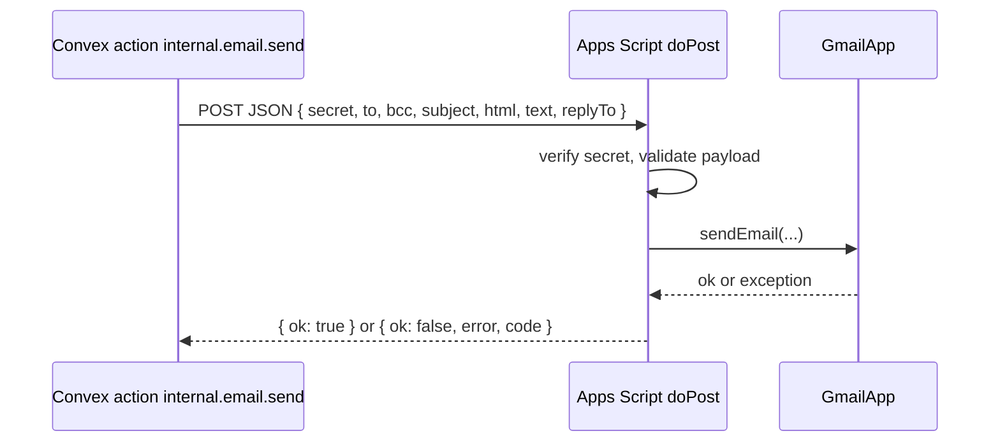

# 06 Email and Google Drive via Google Apps Script

## Why

The Hub sends one email: the [daily digest](features/notifications-and-email.md#daily-digest). It goes out from a **dedicated free Gmail account** created just for CSSA Hub (not anyone's personal account), so the sender stays the same across officer terms. A Google Apps Script web app on that account sends through its Gmail for free, with no third-party email provider. Convex calls the script over HTTPS.

The same script also stores large files in that account's **Google Drive** ([files.md](features/files.md#google-drive)): files over 10 MB, and uploads to a space that is out of quota.

The script is a **thin relay**: Convex decides who gets what, renders every email and checks every upload. The script only checks the secret, then sends, or opens, verifies, shares and trashes Drive files.

## Overview



## Request contract

`POST <APPS_SCRIPT_URL>` with `Content-Type: application/json` (Apps Script receives it as `e.postData.contents`). Every request has `secret` and `action`; Convex sends them through `callAppsScript` in `convex/lib/appsScript.ts`. A request without `action` is treated as `sendEmail`.

### `sendEmail`

```json
{
  "action": "sendEmail",
  "secret": "<APPS_SCRIPT_SHARED_SECRET>",
  "jobId": "k17abc...",
  "to": "student@ucsb.edu",
  "bcc": ["a@ucsb.edu", "b@ucsb.edu"],
  "subject": "【CSSA Hub】今日待办：2 项今天截止",
  "html": "<p>...</p>",
  "text": "...",
  "replyTo": "cssa@example.com"
}
```

- `to` or `bcc` must be present. The digest uses `to` only (one person per request); `bcc` is kept for future use, at most 50 addresses per request.
- `jobId` is for logging only.

### Google Drive

| Action | Request | Reply when `ok` |
| --- | --- | --- |
| `driveSession` | `name`, `size` (bytes, at most 500 MB), `mimeType`, `folder` (space key such as `events` or `public`), `origin` (the site origin) | `uploadUrl`: a resumable upload session in `CSSA Hub Files/<folder>` |
| `driveFinalize` | `fileId` | `name`, `size`, `mimeType`, after checking the file is under `CSSA Hub Files` and setting it to "anyone with the link can view" |
| `driveTrash` | `fileId` | Moves the file to the Drive trash (only files under `CSSA Hub Files`) |

- The session is created with the Drive API (`ScriptApp.getOAuthToken()` and `UrlFetchApp`), passing `origin` as the `Origin` header so Drive accepts the browser's cross-site `PUT` to the session URL.
- `CSSA Hub Files` is created on first use; its id is kept in the `DRIVE_ROOT_ID` script property. One subfolder per space, named by space key.
- `driveSession` returns `DRIVE_FULL` when the account's 15 GB is used up.

## Response contract

Apps Script web apps always answer HTTP 200 (after a redirect), so the result is in the JSON body:

```json
{ "ok": true }
```

```json
{ "ok": false, "code": "UNAUTHORIZED" | "INVALID" | "QUOTA" | "DRIVE_FULL" | "SEND_FAILED", "error": "message" }
```

The Convex action must follow redirects (`fetch` does by default) and parse the body. On `QUOTA`, it pauses sending until the next day (see [notifications-and-email.md](features/notifications-and-email.md#pipeline)).

## Apps Script source (`google-apps-script/Code.gs`)

The script lives in [`google-apps-script/Code.gs`](../google-apps-script/Code.gs); paste the whole file into the Apps Script editor. It:

- Reads `SHARED_SECRET` from Script Properties and compares it in constant time; anything else gets `UNAUTHORIZED`.
- Checks that `subject` and `html` are present, and that every address in `to` and `bcc` looks valid (at most 50 in `bcc`); otherwise `INVALID`.
- Returns `QUOTA` when `MailApp.getRemainingDailyQuota()` is lower than the number of recipients.
- Sends with `GmailApp.sendEmail` as "CSSA Hub", with `replyTo` when given; any exception becomes `SEND_FAILED`.
- Answers `GET` with `{ "ok": true }`, so opening the `/exec` URL in a browser confirms the deployment is reachable.
- Routes Drive actions as described [above](#google-drive), only ever touching files inside `CSSA Hub Files`.
- Has a `setup()` function that emails the script's own account and creates the `CSSA Hub Files` folder. Run it once from the editor to grant the Gmail and Drive permissions.

## Deployment steps

1. Create a dedicated Gmail account for CSSA Hub (keep its password with the 主席团 handover notes), sign in to it, and create a new Apps Script project named "CSSA Hub Relay".
2. Paste `Code.gs`.
3. **Project Settings, then Script Properties**: add `SHARED_SECRET` with a long random value (for example `openssl rand -hex 32`).
4. **Deploy, then New deployment, then Web app**:
   - Execute as: **Me** (the CSSA account).
   - Who has access: **Anyone** (the shared secret is what protects it).
5. Select `setup` in the editor toolbar and click **Run**. Approve the Gmail, Drive and external request permissions, then check the CSSA inbox for the test email and Drive for the `CSSA Hub Files` folder.
6. Copy the web app URL (`https://script.google.com/macros/s/.../exec`).
7. In Convex (dashboard or CLI), set environment variables for each deployment:
   - `APPS_SCRIPT_URL`
   - `APPS_SCRIPT_SHARED_SECRET`
   - `EMAIL_REPLY_TO` (optional)
8. When `Code.gs` changes, paste it, run `setup` again if Google asks for new permissions, then **Deploy, Manage deployments, Edit, Version: New version** so the URL stays the same.
9. Test a Drive upload: upload a file over 10 MB to any folder in 文件. If the browser reports a CORS error on the `PUT`, check that `SITE_URL` in Convex is the real site address.

Use a separate Apps Script deployment (or at least a separate secret) for dev and prod, so local testing never emails real members. In dev, set `EMAIL_DRY_RUN=true` to make `internal.email.send` log the payload and mark the job `sent` without calling the script.

## Quotas

| Account type | Approx. recipients per day |
| --- | --- |
| Free Gmail | 100 |
| Google Workspace | 1,500 |

Each address in `to` and `bcc` counts. The Hub sends at most one email per person per day, only to people with open tasks or upcoming events, so a free account lasts until about 90 such people on the same day. Past that, the rest of the day's digests are skipped (see [the pipeline](features/notifications-and-email.md#pipeline)). Check the current limits in Google's documentation before launch.

## Templates

Rendered in `convex/lib/emailTemplates.ts`, with a `zh` and an `en` version, each with subject, HTML and plain text. The layout is simple dark-on-light HTML (most email clients handle light backgrounds better), with a gold button that opens the 任务 page.

| Template | Params | Subject (zh / en) |
| --- | --- | --- |
| `daily_digest` | `today[]`, `events[]`, `todos[]` | 【CSSA Hub】今日待办：{n} 项 / Today: {n} items, or 【CSSA Hub】每日摘要 / Daily summary when nothing is due today |

Each item has a title, chat name, kind (任务 / 活动), due date or time and place, and a link. Escape all user-provided values when building HTML.
