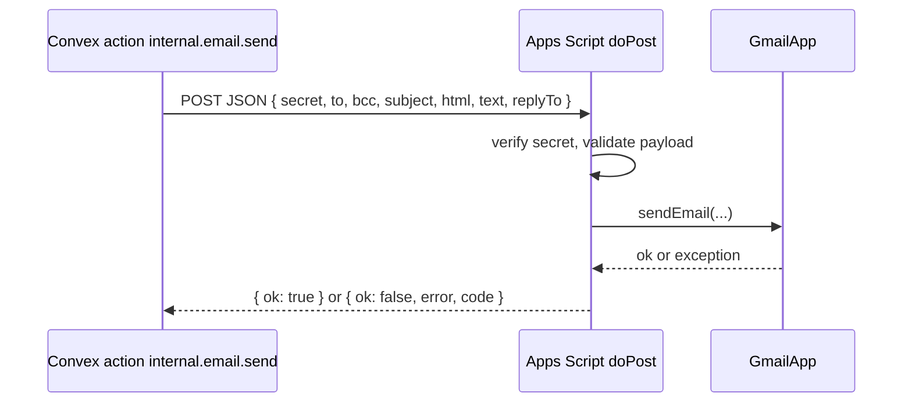

# 06 Email via Google Apps Script

## Why

CSSA already has a Google account. A Google Apps Script web app can send mail through that account's Gmail for free, with no third-party email provider. Convex calls the script over HTTPS.

The script is a **thin relay**: Convex decides who gets what and renders the subject and body. The script only checks the secret and sends.

## Overview



## Request contract

`POST <APPS_SCRIPT_URL>` with `Content-Type: application/json` (Apps Script receives it as `e.postData.contents`).

```json
{
  "secret": "<APPS_SCRIPT_SHARED_SECRET>",
  "jobId": "k17abc...",
  "to": "student@ucsb.edu",
  "bcc": ["a@ucsb.edu", "b@ucsb.edu"],
  "subject": "【CSSA Hub】新任务：迎新晚会海报设计",
  "html": "<p>...</p>",
  "text": "...",
  "replyTo": "cssa@example.com"
}
```

- `to` or `bcc` must be present. `bcc` is used for announcement emails, chunked to at most 50 addresses per request.
- `jobId` is for logging only.

## Response contract

Apps Script web apps always answer HTTP 200 (after a redirect), so the result is in the JSON body:

```json
{ "ok": true }
```

```json
{ "ok": false, "code": "UNAUTHORIZED" | "INVALID" | "QUOTA" | "SEND_FAILED", "error": "message" }
```

The Convex action must follow redirects (`fetch` does by default) and parse the body. On `QUOTA`, it pauses sending until the next day (see [notifications-and-email.md](features/notifications-and-email.md#pipeline)).

## Apps Script source (`google-apps-script/Code.gs`)

Reference implementation to keep in the repo and paste into the Apps Script editor:

```javascript
const SECRET = PropertiesService.getScriptProperties().getProperty("SHARED_SECRET");
const SENDER_NAME = "CSSA Hub";

function doPost(e) {
  try {
    const body = JSON.parse(e.postData.contents);
    if (!SECRET || body.secret !== SECRET) {
      return json({ ok: false, code: "UNAUTHORIZED", error: "bad secret" });
    }
    if ((!body.to && !(body.bcc && body.bcc.length)) || !body.subject || !body.html) {
      return json({ ok: false, code: "INVALID", error: "missing fields" });
    }
    const recipients = (body.to ? 1 : 0) + (body.bcc ? body.bcc.length : 0);
    if (MailApp.getRemainingDailyQuota() < recipients) {
      return json({ ok: false, code: "QUOTA", error: "daily quota reached" });
    }
    GmailApp.sendEmail(body.to || "", body.subject, body.text || "", {
      htmlBody: body.html,
      bcc: (body.bcc || []).join(","),
      name: SENDER_NAME,
      replyTo: body.replyTo || undefined,
    });
    return json({ ok: true });
  } catch (err) {
    return json({ ok: false, code: "SEND_FAILED", error: String(err) });
  }
}

function json(obj) {
  return ContentService.createTextOutput(JSON.stringify(obj))
    .setMimeType(ContentService.MimeType.JSON);
}
```

## Deployment steps

1. Sign in to the CSSA Google account and create a new Apps Script project named "CSSA Hub Mailer".
2. Paste `Code.gs`.
3. **Project Settings, then Script Properties**: add `SHARED_SECRET` with a long random value (for example `openssl rand -hex 32`).
4. **Deploy, then New deployment, then Web app**:
   - Execute as: **Me** (the CSSA account).
   - Who has access: **Anyone** (the shared secret is what protects it).
5. Authorize the Gmail scopes when prompted.
6. Copy the web app URL (`https://script.google.com/macros/s/.../exec`).
7. In Convex (dashboard or CLI), set environment variables for each deployment:
   - `APPS_SCRIPT_URL`
   - `APPS_SCRIPT_SHARED_SECRET`
   - `EMAIL_REPLY_TO` (optional)
8. When `Code.gs` changes, create a **new version** of the existing deployment so the URL stays the same.

Use a separate Apps Script deployment (or at least a separate secret) for dev and prod, so local testing never emails real members. In dev, set `EMAIL_DRY_RUN=true` to make `internal.email.send` log the payload and mark the job `sent` without calling the script.

## Quotas

| Account type | Approx. recipients per day |
| --- | --- |
| Free Gmail | 100 |
| Google Workspace | 1,500 |

Each address in `to` and `bcc` counts. The app design keeps volume low: digests instead of per-message emails, and announcement emails only for users who opt in. Check the current limits in Google's documentation before launch.

## Templates

Rendered in `convex/emailTemplates.ts`. Each template has a `zh` and `en` version with subject, HTML, and plain text. All templates share a simple dark-on-light HTML layout (most email clients handle light backgrounds better), a gold button for the main link, and the footer about email settings.

| Template | Params | Subject (zh / en) |
| --- | --- | --- |
| `account_request` | `applicantName`, `departments` | 【CSSA Hub】新的注册申请 / New account request |
| `preapproval_invite` | `departmentName`, `role`, `by`, `link` | 【CSSA Hub】你已被邀请加入{departmentName} / You've been invited to join {departmentName} |
| `account_approved` | `name`, `departments` | 【CSSA Hub】你的账号已通过审批 / Your account is approved |
| `account_rejected` | `name`, `reason` | 【CSSA Hub】注册申请未通过 / Account request not approved |
| `assignment_new` | `title`, `by`, `dueAt`, `link` | 【CSSA Hub】新任务：{title} / New assignment: {title} |
| `assignment_due_soon` | `title`, `dueAt`, `link` | 【CSSA Hub】任务即将截止：{title} / Due soon: {title} |
| `assignment_overdue` | `title`, `dueAt`, `link` | 【CSSA Hub】任务已逾期：{title} / Overdue: {title} |
| `submission_changes_requested` | `title`, `by`, `comment`, `link` | 【CSSA Hub】任务需要修改：{title} / Changes requested: {title} |
| `creator_summary` | `items[]` | 【CSSA Hub】任务进度日报 / Daily assignment summary |
| `mention_digest` | `items[]` | 【CSSA Hub】你有 {count} 条新提及 / You have {count} new mentions |
| `announcement` | `channel`, `by`, `excerpt`, `link` | 【CSSA Hub】{channel} 新公告 / New announcement in {channel} |

Escape all user-provided values when building HTML.
