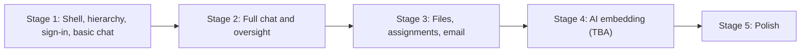

# 09 Roadmap

Build in **stages**. Each stage ends with something usable, and later stages build on earlier ones. Agents should not start a later stage's features unless asked.

Stage 1 is fixed. Stages 2 to 5 are a proposal and can be reordered. Stage 4 is a placeholder until its scope is decided.

---

## Stage 1: Shell, hierarchy, sign-in, basic chat (框架、组织架构、登录、基础聊天)

**Goal:** a rough but working app. People sign in with their UCSB Google account, land in the right place in the CSSA hierarchy, can see the whole organization on a roster page, and can send messages in real time.

### In scope

**Project setup**
- [x] Next.js (App Router, TypeScript) + Tailwind + shadcn/ui with the dark theme from [04-design-system.md](04-design-system.md). A rough UI is fine, but use the theme tokens from day one.
- [x] `next-intl` with `zh` default and `en`, plus the 中 / EN toggle ([05-i18n.md](05-i18n.md)). Set this up now; adding it later is expensive.
- [x] Convex project with the **Stage 1 tables** from [03-data-model.md](03-data-model.md): `users`, `departments`, `departmentMemberships`, `preApprovals`, `channels`, `channelMembers`, `messages`, `auditLogs`.
- [x] `backend/convex/lib/permissions.ts` with the Stage 1 helpers and permission tests.
- [x] CI: lint, typecheck, tests, i18n key check, static build.
- [x] Deploy: GitHub Actions deploys Convex and publishes the static site to GitHub Pages.

**Sign-in and accounts** ([features/accounts-and-onboarding.md](features/accounts-and-onboarding.md))
- [x] Google OAuth through Convex Auth, verified `@ucsb.edu` emails only.
- [x] **First account becomes system admin** automatically (approved, full access to every page).
- [x] Short onboarding: 中文名, English name, and the oversight notice checkbox.
- [x] **Pre-approved emails** skip the approval queue and are placed straight into their department and role.
- [x] Other users wait on a "pending approval" screen. Admins and leads approve them from the roster page.

**Hierarchy and roster** ([features/roster.md](features/roster.md))
- [x] Seed departments: 主席团, 活动部, 国际部, 宣传部. Admins can create and rename departments.
- [x] Roles: system admin, 主席团, 部长 (1 to 2 per department), 部员.
- [x] Roster page visible to every approved user: 主席团 at the top, then each department with its leads and members.
- [x] Admins and leads on the roster: pre-approve emails, approve pending users, add or remove members, change roles (within their permissions).

**Basic chat** ([features/chat.md](features/chat.md))
- [x] Channels: one org-wide channel (全体), one channel per department (access derived from the hierarchy), and DMs.
- [x] Send text messages in real time; load older messages with a "load older" button.
- [x] Unread badges and mark-as-read.
- [x] Start a DM from a person on the roster.

**App shell**
- [x] Sidebar: Chat, Roster, Settings. Files and Assignments show as disabled "即将推出 / Coming soon" items.
- [x] Settings: profile names and language.
- [x] Mobile layout works at a basic level (bottom tabs or sheet).

### Not in Stage 1

Deferred to later stages: group chats, announcement channels, attachments, mentions, reactions, editing or deleting messages, in-app notifications, the oversight view and audit log viewer, files, assignments, and email.

Audit log **rows** are still written in Stage 1 for approvals, pre-approvals, and role changes, so history exists from the start. The viewer comes later.

### Exit criteria

Check these on the deployed site with real Google accounts. The backend rules behind them are covered by `backend/tests/`.

- [ ] The first person to sign in becomes system admin and can open every page.
- [ ] An email pre-approved into 活动部 as 部员 signs in for the first time, completes the short onboarding, and appears under 活动部 on the roster without anyone approving them.
- [ ] A non-pre-approved `@ucsb.edu` user lands on the pending screen until an admin or lead approves them.
- [ ] A non-`@ucsb.edu` account cannot sign in.
- [ ] Two members of the same department see each other's messages in the department channel instantly.
- [ ] A member can DM anyone on the roster.
- [ ] The whole UI works in Chinese and English.

---

## Stage 2: Full chat and oversight (完整聊天与监督)

**Goal:** a department can run its daily coordination in the app instead of GroupMe or WeChat, everyone can see that chats are monitored, and chat content does not pile up forever.

### Decisions (2026-10-20)

These replace the older wording in [features/chat.md](features/chat.md), [03-data-model.md](03-data-model.md), and the chat permission matrix in [02-roles-and-permissions.md](02-roles-and-permissions.md); those docs are updated in step 2.1.

| Topic | Decision |
| --- | --- |
| Message retention | Messages are kept **15 days** by default, then deleted from the server. Admins and leads can extend a chat to 1, 3, 6, or 12 months. |
| Attachments | Images and other files, **15 MB** max each. Nothing large loads automatically: images show a small thumbnail, and the full file loads only when the user clicks download. Attachment files are always deleted **15 days** after sending, even in chats with longer retention. Larger files: upload to Google Drive and send the link (the composer says so). |
| Delete | Authors can't delete. The author can **recall** (撤回) a message within **5 minutes**; it then shows "{name} 撤回了一条消息 / {name} recalled a message". The text and attachments are erased, not kept. |
| Edit | The author can edit their messages. Edited messages show "(已编辑 / edited)", and everyone who can read the chat can open the full edit history. |
| Moderation | 主席团 (and system admins) can remove anyone's message. It shows "该消息已被主席团移除 / Removed by the presidium", the content is erased, and the removal is audit logged. |
| Oversight visibility | Every monitored chat shows an icon in the header (top right); hovering lists who can view it. Existing users re-accept an updated notice on their next login. |
| Reactions | A fixed set of 8 emoji, no picker library. |
| Announcement channels | Only leaders post; everyone who can read can react. |
| Group chats | 部员 can't create groups. They propose one with the departments it involves. A 部长 of any involved department (or 主席团 / system admin) approves it and picks the members. The 部长 of every involved department are in it automatically and add their own department's members. |
| Chat apps | 接龙 (sign-up list), 投票 (vote), and 集会 (weekly meeting finder). Leaders start them directly; members propose and a leader in that chat approves. Running apps show as rounded chips in a bar under the chat header. |
| 投票 options | Whoever starts the vote picks named or anonymous, and when results show (live, after voting, or after closing). An optional "其他 / Other" answer with free text. |
| Multi-select | Select several messages to forward them to other chats as one combined chat record (合并转发), or to delete them locally (hidden on this browser only). |

**Also decided:**

- **Who sets retention:** admins on any chat; 部长 on their own department's channels and on group chats they belong to. DMs: admins only. Announcement channels also default to 15 days.
- **Oversight scope** stays as documented: leads of both departments can read a cross-department DM ([Q1](10-open-questions.md#q1-cross-department-dms)), only 主席团 reads leads' chats ([Q2](10-open-questions.md#q2-leads-own-dms-and-group-chats)), and an overseen member's department channels are included.

### Build order

Each step ships on its own, with backend tests, and leaves the app working.

**Status (2026-10-19):** steps 2.1 to 2.9 are implemented, with backend tests for each. The exit criteria below still need to be checked against a real deployment.

| Step | Scope |
| --- | --- |
| 2.1 | Schema migration, updated notice (consent v2), retention and purge cron, recall, edit with history, moderation removal, replies, reactions, mentions, markdown, mute, monitored icon |
| 2.2 | Group chats, announcement channels, system messages |
| 2.3 | Attachments with thumbnails, download, expiry |
| 2.4 | In-app notifications (bell, `/notifications`) |
| 2.5 | Oversight section, read-only banner, audit logging, "who can see my content" |
| 2.6 | Search within a channel (works for Chinese) |
| 2.7 | Admin console: overview, audit log viewer, department archive |
| 2.8 | Multi-select: combined forward, delete locally, copy |
| 2.9 | Chat apps: 接龙, 投票, 集会, with the proposal and approval flow |

The updated notice ships in 2.1 because retention starts deleting content, and members must be told before that happens.

### 2.1 Core chat

**Schema changes**
- `channels`: add `announcement` and `group` types, `name`, `retentionDays` (15, 30, 90, 180, or 365; default 15), `archivedAt`.
- `channelMembers`: add `muted`, `joinedAt`.
- `messages`: add `kind` (`user`, `system`, or `forward` from step 2.8), `mentionUserIds`, `mentionAll`, `replyToId`, `editedAt`, `recalledAt`, `removedAt`, `removedBy`, `searchText` (step 2.6), and `systemEvent` params for system messages.
- New `messageReactions`, and `messageEdits` (`messageId`, previous `body`, `editedAt`), which holds each earlier version.

**Updated notice (consent v2)**
- Bump `CURRENT_CONSENT_VERSION` to 2. The text adds: 15-day retention, recall, the monitored icon, and that profile photo, names, and bio are public on the CSSA website.
- Existing users see a full-screen re-accept page on their next visit. A user who declines can't use the app but can still request deactivation.
- If the version changes while someone is using the app, the status gate switches them to the re-accept page in real time.

**Retention**
- The cutoff is `now - retentionDays`, measured from when each message was sent.
- An hourly cron deletes expired messages per channel in batches (500 per run, then reschedules itself), along with their reactions and edit history.
- Shortening retention needs a confirm dialog that warns older messages will be deleted on the next run. Extending cannot bring back messages already deleted.
- Every retention change is audit logged (`channel.retention_change`).
- Audit logs are never purged. Notifications that point to a purged message open the chat and show "消息已过期 / Message expired".
- Any Stage 1 message older than 15 days is deleted on the first run. Production has none yet.

**Recall**
- Allowed only for the author, within 5 minutes by server time. The button disappears after 5 minutes; the server enforces the limit regardless of the client clock.
- Clears the body, mentions, reactions, and edit history, deletes the attachment files, and deletes the `mention` notifications it created.
- Recalled messages don't count as unread and don't show in search.
- A reply quoting a recalled message shows "原消息已撤回 / Original message recalled".
- Not available through oversight.
- The 5-minute window counts from when the message was sent, not from its last edit.

**Edit**
- Only the author, on their own messages that haven't been recalled or removed, with no time limit. The new body follows the same rules as sending (not empty, 4,000 characters max).
- Each edit saves the previous body to `messageEdits` and sets `editedAt`.
- The message shows "(已编辑 / edited)". Clicking it lists every earlier version with its time; anyone who can read the chat, including overseers, can see it.
- Mentions are re-read from the new body. Only people newly mentioned get a notification; removed mentions don't take notifications back.
- Attachments can't be added or removed by editing.
- Not available through oversight.

**Moderation removal**
- 主席团 and system admins can remove any message in any chat they can read, after a confirm dialog.
- Erases the content the same way recall does, including edit history and attachments. Shows "该消息已被主席团移除 / Removed by the presidium".
- Writes `message.moderate_remove` to the audit log, recording who removed it, the author, and the channel. The removed text is not stored.
- Through oversight it's still allowed, since 主席团 oversees every chat. It's the only write action allowed through oversight.

**Replies**
- `replyToId` must point to a message in the same channel. The quote shows the author and the first line.
- If the original is recalled or purged, the quote shows a placeholder.

**Mentions**
- Stored as user-ID markers in the body (`<@id>`), so renamed users display correctly.
- The `@` picker lists the people who can read the channel as participants. The server drops IDs of people who can't read it.
- `@all` / `@所有人`: admins in any channel they can post in, and leads in their own department's channels.
- Nobody gets a notification for mentioning themselves. Mentions still notify in muted chats.

**Reactions**
- Fixed set: 👍 ❤️ 😂 🎉 👀 🙏 ✅ 🔥. Toggled on and off; the tooltip shows who reacted.
- Allowed for anyone who reads the channel as a participant, including in announcement channels.
- Not allowed through oversight or on recalled messages.

**Markdown**
- Bold, italic, inline code, code blocks, and auto-linked URLs. No raw HTML and no markdown images.
- Rendered with `react-markdown` limited to an allow-list of elements.

**Mute**
- Muted chats show a dot instead of a count.
- Announcement channels can't be muted.

**Monitored icon**
- Shown in the header of every chat, top right; hover or tap shows a tooltip.
- DMs, groups, and department channels list who can view them: "可查看：主席团；活动部部长 Alice、Bob". The list comes from a `channels.watchers` query using the same `oversees` rule as the server.
- `org` and announcement channels say "全体成员可见 / Visible to all members".

### 2.2 Group chats and announcement channels

**Group chats belong to departments**

Every group lists one or more **involved departments** (`channels.departmentIds`). 部员 can't create groups; they **propose** one, and a leader of an involved department approves it and decides who's in it.

Example: someone in 活动部 needs a poster but doesn't know who in 宣传部 to ask. They propose "迎新海报" with 活动部 and 宣传部. Either department's 部长 approves it, the 部长 of both departments are in the group automatically, and each 部长 pulls in the members of their own department.

| Who | Can do |
| --- | --- |
| 部员, or approved with no department | Propose a group |
| 部长 | Create a group directly; it must include at least one department they lead. Approve proposals that involve their department. |
| 主席团, system admins | Create a group directly with any departments, or none (for example an org-wide committee). Approve any proposal. |

**Proposing**
- The proposer fills in:
  - a name (up to 40 characters);
  - a purpose (required, up to 200 characters, e.g. "做迎新海报");
  - the involved departments: their own department is selected by default, they add others, and there must be at least one;
  - optionally, suggested members from the involved departments.
- Approvers are the 部长 of every involved department, plus 主席团 and system admins. They all get a `group_proposed` notification. Pending proposals also show in a "待审批群聊 / Groups to approve" list in the chat sidebar, with a count.
- The proposer sees their proposal's status in the same place and can cancel it while it's pending.
- **One approval is enough.** When approving, the approver:
  - can change the name;
  - can drop suggested members;
  - can add members of the departments they lead (主席团 and system admins can add anyone).
- If a second approver acts at the same moment, they get "already reviewed".
- **Reject:** a reason is required and sent to the proposer as `group_rejected`.
- **Expiry:** a proposal nobody acts on expires after 14 days and the proposer is told. It's also cancelled if the proposer is deactivated.

**Who is in a group**
- **Explicit members:** the proposer and everyone added. Stored in `channelMembers`.
- **The 部长 of every involved department, automatically.** This is derived like department channel access, not stored. A newly appointed 部长 is in straight away, and a 部长 who steps down loses access unless they were also added as a member.
- Automatic 部长 can't leave while their department is involved, but they can mute the chat.
- People added to a group see the existing history, within retention. Max 100 people.

**Managing a group**

| Action | Who |
| --- | --- |
| Add members | 部长: members of departments they lead. 主席团 and system admins in the group: any approved user. |
| Remove members | 部长: members of departments they lead. 主席团 and system admins: anyone except the automatic 部长. |
| Rename, set retention, end the group | Any 部长 of an involved department, or 主席团 / system admins in the group |
| Add another department | Same as above. That department's 部长 join automatically and get `added_to_group`. |
| Remove a department | Same as above. Its 部长 lose automatic access; members added under it stay until removed. A group needs at least one department, unless it was created by an admin with none. |
| Leave | Any explicit member |

**主席团 take over when a department loses its 部长**

If an involved department is archived, or its last 部长 is removed or demoted, nobody would be left to manage that department's side of the group. In that case **all of 主席团 automatically become members and managers of the group**.

- **How it works:** derived like the automatic 部长, not stored. It applies while at least one involved department is archived or has no 部长.
- **When it ends:** once every involved department has a 部长 again, or the archived department is removed from the group. A 主席团 member who was also added explicitly stays.
- **The 部长 who was removed** loses automatic access, unless they were also added as a member.
- **Messages:** the group shows a system message, "活动部暂无部长，主席团已接管本群管理 / 活动部 has no 部长; 主席团 now manage this group", and another when it ends.
- **Notifications:** each 主席团 member gets one `group_takeover` notification per event, listing the affected groups, not one per group.
- **The group stays fully usable.** Archived departments show as "已归档" in its department list.

**Edge cases**
- **Someone leaves a department:** they stay in its groups, because group membership is explicit. A 部长 or 主席团 can remove them.
- **A department has no 部长 right now:** proposals involving only that department go to 主席团 and system admins.
- **Ending a group:** it becomes read-only for everyone and is purged once its retention has passed.
- **Deactivated users** stay in the member list, greyed out.
- **DMs don't change:** any approved user can still DM anyone. A DM with a deactivated user becomes read-only.

**System messages** for creation ("由 Alice 申请，Bob 批准"), joins, removals, leaving, departments added or removed, renames, and retention changes. They're stored as `kind: "system"` with params and translated when shown.

**Data model**
- `channels`: add `departmentIds` and `endedAt` for groups.
- `channelMembers`: drop the group `role` planned in 2.1 and add `addedBy`.
- New `groupProposals`: `proposerId`, `name`, `purpose`, `departmentIds`, `suggestedUserIds`, `status` (`pending`, `approved`, `rejected`, `cancelled`, `expired`), `reviewedBy`, `reviewNote`, `channelId`, `expiresAt`. Indexes by proposer and by status.

**Announcement channels**

> Changed 2026-10-22: announcements now live inside the 全体 and department chats as flagged messages, with their own unseen badge and a 知道了 bar; the channels below were merged by a migration. See [features/chat.md](features/chat.md#announcements-公告).

- **Org-wide 全体公告:** admins post.
- **Department announcement channels:** that department's leads and admins post. Each department gets one when it's created; a migration creates them for existing departments.
- **Notifications:** every new post sends an `announcement` notification to every reader except the author. A scheduled internal mutation sends these in batches of 200.
- **Archived department:** all of its channels become read-only.

### 2.3 Attachments

**Upload**
- Up to 10 files per message, 15 MB each.
- Files over 15 MB are rejected in the browser with "超过15MB，请上传到 Google Drive 后发送链接 / Over 15 MB: upload to Google Drive and send the link".
- A new `attachments` table holds `storageId`, `thumbStorageId`, `name`, `size`, `contentType`, `uploaderId`, `messageId?`, `channelId?`, and `expiresAt`.
- After an upload, `attachments.register` validates the size against `_storage` and creates the row with no message yet, expiring in 24 hours.
- `messages.send` only accepts attachment rows that the sender owns and that aren't attached to anything yet. This stops anyone attaching someone else's upload. Sending sets `expiresAt` to send time plus 15 days.

**Display**
- Images get a thumbnail made in the browser (about 320 px, 20 to 40 KB), stored as a second file. The thumbnail shows inline; the full image opens or downloads on click.
- SVG and HTML files are never rendered inline; they show as file cards.
- Other files show as a card with name, size, and a download button.

**Expiry**
- An hourly cron deletes expired storage files: unsent uploads after 24 hours, sent attachments after 15 days.
- The message keeps a "文件已过期 / File expired" card.

**Known limit:** Convex file URLs work for anyone who has the link until the file is deleted, so at most 15 days. The privacy notice says so.

### 2.4 In-app notifications

- **Table:** `notifications` as in [03-data-model.md](03-data-model.md). Stage 2 types: `mention`, `reply`, `announcement`, `added_to_group`, `added_to_department`, `deactivation_reviewed`, `group_proposed`, `group_approved`, `group_rejected`, `group_expired`, `group_takeover`, plus the chat-app types from step 2.9 (`app_proposed`, `app_approved`, `app_rejected`, `app_due_soon`).
- **Bell:** in the app shell, showing the unread count (99+ above 99).
- **`/notifications` page:**
  - paginated, newest first;
  - clicking a notification marks it read and opens `/chat/?c=<channel>&m=<message>`;
  - "全部标为已读 / Mark all as read".
- **Display text:** rendered from `type` + `params` in the viewer's language. The text itself is never stored.
- **Who doesn't get them:** overseers (they're not participants), the author of the message, and recipients who have since lost access. Access is checked when the notification is created and again when it's opened.
- **Cleanup:** a daily cron deletes read notifications older than 90 days.

### 2.5 Oversight

**Oversight section**
- In the chat sidebar, shown only to admins and leads, collapsed by default.
- Organized by person, because 主席团 can see every chat and a flat list wouldn't scale. Pick someone you oversee to see their DMs, groups, and department channels.
- The roster person drawer gets a "查看聊天（监督）" shortcut to the same view.

**Opening a chat through oversight**
- A gold read-only banner. No composer, reactions, edit, or recall; only 主席团's moderation removal still works. Read state isn't changed.
- The client calls `channels.recordOversightOpen` once per open, which writes `oversight.channel.open`. Repeat calls for the same viewer and channel within 10 minutes are ignored, so re-renders don't flood the log.
- If oversight ends while the chat is open (the member leaves the department, or the lead is demoted), the query returns NOT_FOUND and the view shows "你已无权查看 / You no longer have access".
- If the viewer is also a participant, the chat opens as a normal chat, not through oversight.

**Settings, "who can see my content"**
- Lists the system admins, 主席团, and the leads of each department you're a member of. Updates in real time.
- Repeats the notice and the retention rules.

### 2.6 Search within a channel

Convex text search splits words on spaces, so it can't find Chinese words inside a sentence. To work around it:

- `messages.searchText` stores the body in lowercase with each run of Chinese characters split into overlapping two-character pairs (明天活动 becomes 明天 天活 活动).
- Queries are converted the same way and capped at 16 terms, Convex's limit.
- Results are double-checked with a plain substring match, so only real matches show.
- Up to 50 results, newest first. Recalled and purged messages are excluded.
- Clicking a result calls `messages.around(messageId)` to load the messages around it and highlights the match.
- Through oversight, search is read-only and covered by the same audit row as the open.

### 2.7 Admin console ([features/admin-console.md](features/admin-console.md))

**`/admin` overview**
- Admins see org-wide counts; leads see their own departments.
- Cards: pending approvals, unclaimed pre-approvals, pending deactivation requests, active members, members per department, and file storage used (admins only, so the 1 GB free limit is visible).

**`/admin/audit`**
- 主席团 and system admins only.
- Filters: actor, subject, action, and date range. Uses the most selective index, then filters the rest.
- Paginated, with translated action labels. Read-only; CSV export is Stage 5.

**Department archive**
- Admins only, with the typed phrase `将{部门中文名}设为已归档`. 主席团 can't be archived. Archiving can be undone.
- The department disappears from pickers and its department and announcement channels become read-only. Memberships are kept, but 部长 permissions stop. Group chats involving it are taken over by 主席团 (see 2.2) instead of becoming read-only.
- Members whose only department was archived show under "未分配部门".

### 2.8 Multi-select, forward, delete locally

**Selecting**
- Start from a message's menu with "多选 / Select" (long-press on mobile). Each message gets a checkbox, and an action bar replaces the composer.
- Up to 50 messages at a time.
- System messages, recalled messages, and removed messages can't be selected.
- Not available through oversight, except copy.

**Actions**

| Action | What it does |
| --- | --- |
| 合并转发 Forward | Sends one "chat record" message to up to 5 chats you can post in |
| 本机删除 Delete locally | Hides the messages on this browser only; nothing changes on the server |
| 复制 Copy | Copies the selected messages as text: name, time, body |

**Forward (combined chat record)**
- The forwarded message is a card titled "{chat name} 的聊天记录" (for a DM, "Alice 和 Bob 的聊天记录"), previewing the first 3 lines. Opening it shows each message with author, time, body, and attachment cards.
- It's a **snapshot**: the content is copied into the new message (`kind: "forward"`). Later edits, recalls, or removals of the originals don't change it. 主席团 can remove the forward itself like any other message.
- Attachments aren't copied. The card points to the same files and shows "文件已过期" once those expire, 15 days after the original was sent.
- Mentions inside forwarded content don't notify anyone again.
- A forward can contain an earlier forward, up to 3 levels deep. Size limit is 200 KB of text per forward.
- Single messages can be forwarded from the message menu too, with the same card.
- The forward follows the target chat's retention.

**Delete locally**
- Stored in the browser's local storage, keyed by user and message, so it only affects this browser on this account.
- Other people, your other devices, and overseers still see the messages. The confirm dialog says so.
- Hidden messages still count toward unread. "恢复本机已删除的消息 / Restore locally deleted messages" in the chat menu brings them back. Clearing browser data also brings them back.

### 2.9 Chat apps: 接龙, 投票, 集会

Shared rules for all three.

**Where**
- Org, department, announcement, and group chats. Not DMs.
- At most 5 running apps per chat.

**Who starts them (approvers)**

| Chat | Can start directly and approve proposals |
| --- | --- |
| 全体 (org) | 主席团, system admins |
| Announcement | Whoever can post there |
| Department | That department's 部长, 主席团, system admins |
| Group | The 部长 of the involved departments, plus 主席团 and system admins who are members. When a department loses its 部长, 主席团 take over (see 2.2), so a group always has someone who can approve. |

Everyone else in the chat can **propose** one.

**Proposals**
- A proposal shows a "待审批 / Pending approval" chip, visible only to the proposer and the approvers.
- Approvers get an `app_proposed` notification. Any one of them can approve as-is, or reject with a reason, which goes to the proposer as `app_rejected`.
- If an approver loses their role while a proposal is waiting, the proposal stays for the remaining approvers. If the proposer leaves the chat, the proposal is cancelled.

**Running**
- Approving or starting an app posts a system message ("Alice 发起了投票：午餐选什么"), and the app appears as a rounded chip in a bar under the chat header, like "投票 · 午餐选什么 · 12人".
- Up to 3 chips show, plus "更多". A chip opens the app in a side panel (full screen on mobile).
- Everyone who reads the chat as a participant can respond. Through oversight it's read-only.

**Changing an app**
- The starter can edit the title and description at any time.
- The structure (options, grid, limits) locks after the first response.

**Closing**
- An optional deadline closes the app automatically.
- The starter or an approver can close it early or reopen it.
- Closed apps leave the chip bar and are listed under "已结束 / Ended" in the chat menu.
- 24 hours before a deadline, people who haven't responded get `app_due_soon`.

**Retention, leaving, archiving**
- An app and its responses are deleted when the chat's retention period has passed since it **closed**. Running apps are never purged.
- People who leave the chat or are deactivated keep their responses, shown greyed out. People who join later can respond.
- In an archived department, apps become read-only.

**接龙 (sign-up list)**
- Setup: title, optional description, an optional example line ("姓名 - 套餐 A/B"), and an optional cap on entries (for limited spots).
- Each person adds **one** line (up to 200 characters), and can edit or remove it until the app closes. Lines are numbered in order of first entry.
- Names are always visible to everyone in the chat.
- When the cap is reached, the list shows "已满 / Full", and later people can't add lines. If someone removes their line, the spot opens again.
- "复制为文本 / Copy as text" copies the numbered list, for pasting elsewhere.

**投票 (vote)**
- Setup: 2 to 20 options (up to 80 characters each), single or multiple choice (with an optional maximum), and an optional "其他 / Other" with free text (up to 100 characters).
- The starter also picks **named or anonymous** and **when results show**: live, after you vote, or after it closes. Both lock when the vote starts.
- People can change their vote until it closes.
- **Anonymous votes:** the server stores who voted only to allow one vote each, and no query ever returns voter identities, not to 主席团 and not through oversight. "Other" answers show without names. Anyone with direct database access (the Convex dashboard) could still see voters; the setup screen says so.
- **Named votes:** hovering an option lists who chose it.

**集会 (weekly meeting finder, When2Meet style)**
- Setup: which weekdays, a time range (for example 9:00 to 22:00), 30-minute slots, and the meeting length (for example 1 hour). Times are in Pacific time (UCSB), and the grid says so.
- Each person paints when they're free each week: drag on desktop, tap on mobile. "使用我上次的时间 / Use my last availability" pre-fills from their most recent 集会.
- The heatmap shows how many people are free in each slot. Hovering a slot lists who's free and who isn't.
- "Best times" lists the top 5 start times where the most people are free for the whole meeting length. Ties go to the earlier time.
- When closing, the starter can confirm a time. That posts a system message: "集会时间定为每周三 19:00–20:00".

**Data model**
- `chatApps`: `channelId`, `kind` (`signup`, `poll`, `meeting`), `status` (`proposed`, `active`, `closed`, `rejected`, `cancelled`), `title`, `description`, `config` (per kind), `createdBy`, `approvedBy`, `rejectReason`, `deadline`, `closedAt`, `confirmedSlot` (集会).
- `chatAppResponses`: `appId`, `userId`, `data` (per kind), `updatedAt`. One row per person per app.
- Deadlines use `ctx.scheduler.runAt`, and the hourly purge cron also handles apps.

### Exit criteria

- [ ] A department runs a week of real coordination in the app: group chat, announcements, attachments, mentions.
- [ ] A 活动部 member proposes a group with 宣传部. A 宣传部 部长 approves it and adds two 宣传部 members. Both departments' 部长 are in it automatically, and the member could not have created it alone.
- [ ] When 宣传部 loses its last 部长, 主席团 automatically become members and managers of that group, and they drop out once a new 部长 is appointed.
- [ ] Every chat shows the monitored icon with the correct list of viewers, and existing users re-accept the updated notice.
- [ ] A message older than its chat's retention is gone from the server, and an attachment is gone 15 days after sending.
- [ ] A message can be recalled within 5 minutes and not after.
- [ ] An edited message shows "(已编辑)", and its earlier versions are visible to everyone in the chat.
- [ ] 主席团 can remove someone else's message, and an audit row is written.
- [ ] An overseer sees the banner, cannot post or react, and one audit row is written per open.
- [ ] Searching a Chinese word inside a sentence finds the message.
- [ ] The bell count updates in real time, and notifications show in the viewer's language.
- [ ] Forwarding 10 selected messages to another chat sends one chat-record card with all 10 messages.
- [ ] Deleting messages locally hides them on that browser only.
- [ ] A member's proposed vote appears to everyone only after a leader in that chat approves it. In an anonymous vote, nobody can see who voted for what.
- [ ] A 接龙 with a cap of 10 stops accepting lines at 10.
- [ ] A 集会 with 5 responses suggests the time slot where the most people are free.

## Stage 3: Files, assignments, and email reminders (文件、任务、邮件提醒)

**Goal:** the app replaces Google Drive and Canvas for CSSA work: departments keep their files here, 部长 hand out tasks and organize events like 春晚 here, and everyone gets one morning email with what's on their plate.

These ship together because they depend on each other: task files live in the department file spaces, and the email digest is built from tasks and events. Build order: files, then tasks and events, then the digest. The 文件 and 任务 tabs in the sidebar and the phone bottom bar stop being grayed out when their part ships.

Decisions for this stage (2026-10-22):
- **Storage:** stay on the Convex free plan (1 GB total). 10 MB per file in Convex, a quota per space (default 75 MB, set by 主席团), and a usage card in the admin console. Bigger files (up to 500 MB), or uploads to a full space, go to the CSSA Google Drive (decided 2026-10-26).
- **File spaces:** 公共 (everyone views, 主席团 edits), 主席团 (主席团 only), and one per department (everyone views; members upload and manage their own files; 部长 and 主席团 manage everything). No personal files, so no file oversight.
- **Chat and Files:** chat attachments stay private and expire after 15 days. Files can be shared into chats as link cards, and attachments can be saved to Files.
- **Tasks:** belong to a chat. 主席团 can assign anyone (in 全体); 部长 assign within their department's chat and in groups that involve their department. Publishing posts a card in the chat. Approve or request changes, no scores.
- **Events:** a kind of task with a time, place and helpers, plus optional prep tasks.
- **Email:** only a daily digest at 10:00 AM Pacific from a dedicated free Gmail account, to everyone with something open (no opt-out), at the sign-in email or an address set in Settings. No other emails.

### 3.1 Files ([features/files.md](features/files.md))

- [x] `fileSpaces`, `folders`, `files` tables; space access rules (`spaceAccess`)
- [x] Files home with every visible space and its usage; folder view with breadcrumbs and a list (grid view not built yet)
- [x] Upload with progress and drag and drop; 10 MB, blocked types and quota checked on the server; image thumbnails
- [x] Google Drive overflow: files over 10 MB (up to 500 MB) or that don't fit the quota go to the CSSA Drive through the Apps Script; link-viewable, trashed on purge
- [x] Previews for images, PDF, video, audio
- [x] Rename, move, delete; trash with restore; daily purge cron (rejected uploads are deleted immediately, so no orphan cron)
- [x] Share a file to a chat (link card), and save a chat attachment to Files (shared storage, cleanup checks both)
- [x] File name search
- [x] Admin storage card: total against 1 GB, each space (including its task files), chat attachments; editable quotas
- [x] 文件 tab enabled in the sidebar and bottom bar

### 3.2 Tasks and events ([features/assignments.md](features/assignments.md))

- [x] `assignments`, `assignmentSubmissions`, `assignmentComments` tables; `taskAccess`, `canCreateTaskIn`
- [x] Create (task or event), draft, publish, edit, close, reopen; assign people or everyone in the chat
- [x] Chat card (`kind: "task"`) that stays live; "发布任务" in the composer menu for those allowed
- [x] 任务 page: 我的, 我发布的, 管理; task page for assignees, chat members and reviewers
- [x] Submissions (text, files into the task's folder, link, mark done, auto-approve), late flag
- [x] Review: approve, request changes, comment thread
- [x] Events: time, place, helpers, prep tasks
- [x] Collaborative markdown documents on tasks and events (live editing, markdown shortcuts, .md and PDF export)
- [x] Notifications and pushes: new, updated, due soon, overdue, event soon, submission received, reviewed, comment
- [x] 任务 tab enabled in the sidebar and bottom bar

### 3.3 Daily digest email ([features/notifications-and-email.md](features/notifications-and-email.md#daily-digest))

- [x] Apps Script relay on a dedicated Gmail account ([06-email-apps-script.md](06-email-apps-script.md))
- [x] `emailJobs` outbox, send action, retry cron, quota skip, dry run in dev
- [x] `daily_digest` template in zh and en: today, events in the next week, to-dos
- [x] Hourly cron that sends at 10:00 AM Pacific, once per person per day, only when there's something to report
- [x] Settings: "接收邮箱 / Send my digest to"
- [x] Admin overview email card (today's sent, failed, skipped, last error)

### Exit criteria

- [ ] A department moves its working files out of Google Drive, staying within its quota.
- [ ] 部长 run a real event (helpers, time, place, prep tasks) end to end in the app, including file submissions and reviews.
- [ ] Everyone with open tasks gets one digest every morning without anyone sending it by hand, and people with nothing get none.

## Stage 4: AI embedding (AI 功能) - TBA

**To be decided.** Scope, features, and providers will be specified before this stage starts. Do not build anything for this stage yet.

Ideas to discuss (not commitments):

- Semantic search across messages, files, and assignments using embeddings (Convex supports vector indexes natively).
- Ask questions about the organization's documents ("去年迎新晚会的预算是多少？").
- Summaries of long channels or catch-up digests ("what did I miss in 活动部 this week").
- Help drafting assignment descriptions or announcements.

Constraints any AI feature must respect:

- **Permissions apply to AI too.** Retrieval must only return content the asking user can already read under [02-roles-and-permissions.md](02-roles-and-permissions.md). Filter search results by permission before passing anything to a model.
- Decide which content is sent to an external AI provider, and update the signup notice if member content leaves the app.
- Bilingual: works for Chinese and English content and questions.

## Stage 5: Polish (完善)

Pick based on feedback:

- [ ] PWA install and web push notifications
- [ ] Global search across messages, files, and assignments
- [ ] Yearly handover flow in admin
- [ ] Audit log CSV export
- [ ] In-app documents (simple rich text pages) if decided in [open questions](10-open-questions.md)
- [ ] Calendar view of task due dates and events
- [ ] Playwright end-to-end tests
- [ ] Performance pass (message list virtualization, image thumbnails)
