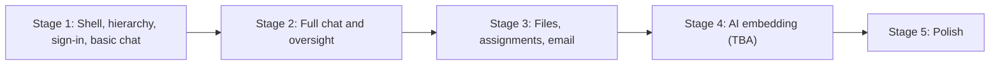

# 09 Roadmap

Build in **stages**. Each stage ends with something usable, and later stages build on earlier ones. Agents should not start a later stage's features unless asked.

Stage 1 is fixed. Stages 2 to 5 are a proposal and can be reordered. Stage 4 is a placeholder until its scope is decided.

---

## Stage 1: Shell, hierarchy, sign-in, basic chat (框架、组织架构、登录、基础聊天)

**Goal:** a rough but working app. People sign in with their UCSB Google account, land in the right place in the CSSA hierarchy, can see the whole organization on a roster page, and can send messages in real time.

### In scope

**Project setup**
- [ ] Next.js (App Router, TypeScript) + Tailwind + shadcn/ui with the dark theme from [04-design-system.md](04-design-system.md). A rough UI is fine, but use the theme tokens from day one.
- [ ] `next-intl` with `zh` default and `en`, plus the 中 / EN toggle ([05-i18n.md](05-i18n.md)). Set this up now; adding it later is expensive.
- [ ] Convex project with the **Stage 1 tables** from [03-data-model.md](03-data-model.md): `users`, `departments`, `departmentMemberships`, `preApprovals`, `channels`, `channelMembers`, `messages`, `auditLogs`.
- [ ] `convex/lib/permissions.ts` with the Stage 1 helpers and permission tests.
- [ ] CI: lint, typecheck, tests, i18n key check.

**Sign-in and accounts** ([features/accounts-and-onboarding.md](features/accounts-and-onboarding.md))
- [ ] Google OAuth through Convex Auth, verified `@ucsb.edu` emails only.
- [ ] **First account becomes system admin** automatically (approved, full access to every page).
- [ ] Short onboarding: 中文名, English name, and the oversight notice checkbox.
- [ ] **Pre-approved emails** skip the approval queue and are placed straight into their department and role.
- [ ] Other users wait on a "pending approval" screen. Admins and leads approve them from the roster page.

**Hierarchy and roster** ([features/roster.md](features/roster.md))
- [ ] Seed departments: 主席团, 活动部, 国际部, 宣传部. Admins can create and rename departments.
- [ ] Roles: system admin, 主席团, 部长 (1 to 2 per department), 部员.
- [ ] Roster page visible to every approved user: 主席团 at the top, then each department with its leads and members.
- [ ] Admins and leads on the roster: pre-approve emails, approve pending users, add or remove members, change roles (within their permissions).

**Basic chat** ([features/chat.md](features/chat.md))
- [ ] Channels: one org-wide channel (全体), one channel per department (membership synced from the hierarchy), and DMs.
- [ ] Send text messages in real time; load older messages on scroll.
- [ ] Unread badges and mark-as-read.
- [ ] Start a DM from a person on the roster.

**App shell**
- [ ] Sidebar: Chat, Roster, Settings. Files and Assignments show as disabled "即将推出 / Coming soon" items.
- [ ] Settings: profile names and language.
- [ ] Mobile layout works at a basic level (bottom tabs or sheet).

### Not in Stage 1

Deferred to later stages: group chats, announcement channels, attachments, mentions, reactions, editing or deleting messages, in-app notifications, the oversight view and audit log viewer, files, assignments, and email.

Audit log **rows** are still written in Stage 1 for approvals, pre-approvals, and role changes, so history exists from the start. The viewer comes later.

### Exit criteria

- [ ] The first person to sign in becomes system admin and can open every page.
- [ ] An email pre-approved into 活动部 as 部员 signs in for the first time, completes the short onboarding, and appears under 活动部 on the roster without anyone approving them.
- [ ] A non-pre-approved `@ucsb.edu` user lands on the pending screen until an admin or lead approves them.
- [ ] A non-`@ucsb.edu` account cannot sign in.
- [ ] Two members of the same department see each other's messages in the department channel instantly.
- [ ] A member can DM anyone on the roster.
- [ ] The whole UI works in Chinese and English.

---

## Stage 2: Full chat and oversight (完整聊天与监督)

- [ ] Group chats (create, rename, add or remove people, leave)
- [ ] Announcement channels (org-wide and per department)
- [ ] Attachments (images inline, other files as cards)
- [ ] Edit, delete, reply, reactions, mentions
- [ ] In-app notifications with the bell and unread count
- [ ] Oversight section, read-only banner, oversight audit logging ([02-roles-and-permissions.md](02-roles-and-permissions.md#oversight-监督查看))
- [ ] Admin console: overview and audit log viewer ([features/admin-console.md](features/admin-console.md))
- [ ] Settings page "who can see my content"
- [ ] Search within a channel

Exit criteria: a department can run its daily coordination in the app instead of GroupMe or WeChat.

## Stage 3: Files, assignments, and email reminders (文件、任务、邮件提醒)

**Goal:** the app replaces Google Drive and Canvas for CSSA work, and reminds people by email so nobody has to chase deadlines by hand.

These three ship together because they depend on each other: assignment submissions use the file upload flow, and email reminders are mostly triggered by assignments. A sensible build order inside the stage is files, then assignments, then email.

### Files ([features/files.md](features/files.md))

- [ ] Spaces: org shared, department, my files
- [ ] Folder tree, breadcrumbs, list and grid views
- [ ] Upload with progress, drag and drop, size and type checks
- [ ] Previews for images, PDF, video, audio
- [ ] Rename, move, delete, trash with restore, purge cron
- [ ] "Save to Files" from chat attachments
- [ ] File name search
- [ ] Oversight access to personal files with audit logging

### Assignments ([features/assignments.md](features/assignments.md))

- [ ] Create, draft, publish, close, reopen
- [ ] Assign to people or a whole department
- [ ] Assigned to me, assigned by me, and department views
- [ ] Submissions (text, files, link, mark done), late flag
- [ ] Review: approve, request changes, comment thread
- [ ] In-app notifications for new assignments and reviews

### Email reminders ([features/notifications-and-email.md](features/notifications-and-email.md))

- [ ] Apps Script relay deployed ([06-email-apps-script.md](06-email-apps-script.md))
- [ ] `emailJobs` outbox, send action, retry cron, quota pause, dry run in dev
- [ ] Templates in `zh` and `en`
- [ ] Emails: account approved or rejected, new account request, pre-approval invite, new assignment, due soon, overdue, changes requested, announcements
- [ ] Daily mention digest and creator summary
- [ ] Email preferences in Settings
- [ ] Admin overview card for failed emails

### Exit criteria

- [ ] A department moves its working files out of Google Drive.
- [ ] Leads track a real event's task list end to end in the app, including file submissions and reviews.
- [ ] Members get due-soon and overdue reminders by email without anyone sending them by hand.

## Stage 4: AI embedding (AI 功能) - TBA

**To be decided.** Scope, features, and providers will be specified before this stage starts. Do not build anything for this stage yet.

Ideas to discuss (not commitments):

- Semantic search across messages, files, and assignments using embeddings (Convex supports vector indexes natively).
- Ask questions about the organization's documents ("去年迎新晚会的预算是多少？").
- Summaries of long channels or catch-up digests ("what did I miss in 活动部 this week").
- Help drafting assignment descriptions or announcements.

Constraints any AI feature must respect:

- **Permissions apply to AI too.** Retrieval must only return content the asking user can already read under [02-roles-and-permissions.md](02-roles-and-permissions.md). Filter search results by permission before passing anything to a model.
- Decide which content is sent to an external AI provider, and update the signup notice if member content leaves the app.
- Bilingual: works for Chinese and English content and questions.

## Stage 5: Polish (完善)

Pick based on feedback:

- [ ] PWA install and web push notifications
- [ ] Global search across messages, files, and assignments
- [ ] Yearly handover flow in admin
- [ ] Audit log CSV export
- [ ] In-app documents (simple rich text pages) if decided in [open questions](10-open-questions.md)
- [ ] Calendar view of assignment due dates
- [ ] Playwright end-to-end tests
- [ ] Performance pass (message list virtualization, image thumbnails)
