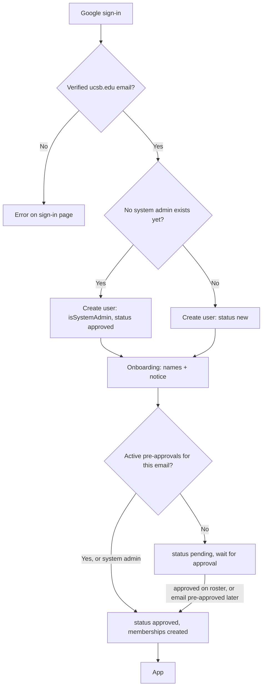
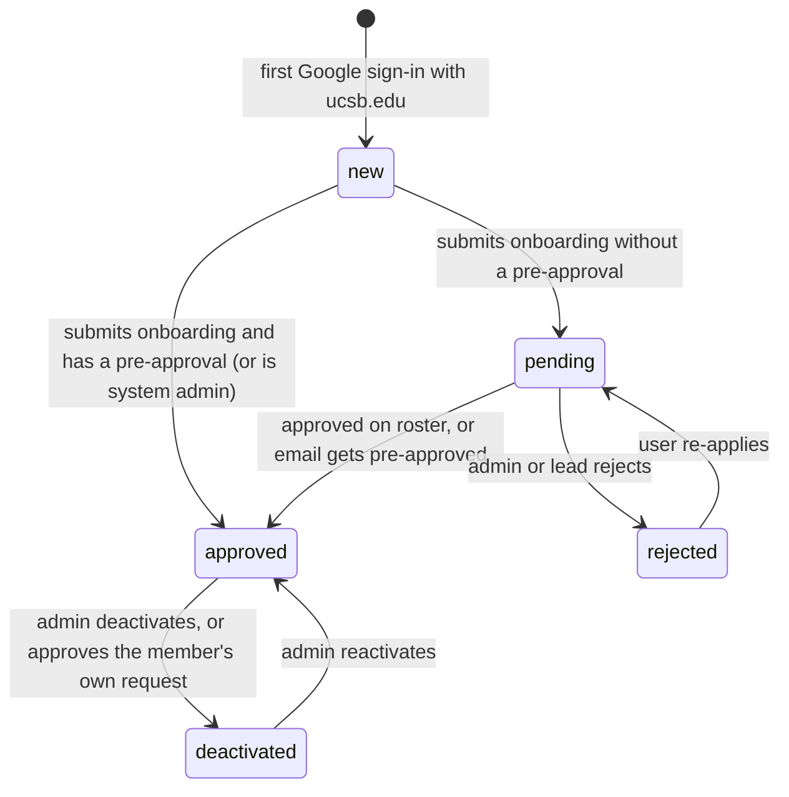

# Feature: Accounts and Onboarding (账号与注册)

## Summary

Only `@ucsb.edu` Google accounts can sign in. There are three ways into the app:

1. **First account ever**: becomes the **system admin** automatically, with full access.
2. **Pre-approved email**: an admin or lead already added this email to a department, so the person is placed into the hierarchy as soon as they finish the short onboarding. No waiting.
3. **Everyone else**: fills out the onboarding form and waits on a "pending" screen until an admin or lead approves them.

Everyone, including pre-approved people, completes a short onboarding step (names + oversight notice) before using the app.

## Sign-in flow

## Account status lifecycle

| Status | What the user sees | Allowed functions |
| --- | --- | --- |
| `new` | Onboarding form | `users.viewer`, `users.submitOnboarding`, `departments.listPublic` |
| `pending` | "Waiting for approval" | `users.viewer`, `users.updateApplication` |
| `rejected` | Reason + "Apply again" button | `users.viewer`, `users.reapply` |
| `approved` | Full app | Everything allowed by role |
| `deactivated` | "Your access has been removed" | `users.viewer` |

The system admin's row is created as `approved`, but they still see the onboarding form once (until `nameZh` and `nameEn` are set) so their profile is complete.

## Sign-in

- Provider: Convex Auth with the Google OAuth provider.
- The client passes the `hd=ucsb.edu` parameter so Google's account picker prefers UCSB accounts. **This hint is not security.**
- Server check: in the Convex Auth `profile` / `createOrUpdateUser` callback, reject unless `email` ends with `@ucsb.edu` (case-insensitive) and Google reports the email as verified. The rejected user sees a translated error on `/sign-in`: "仅限 @ucsb.edu 邮箱登录 / Only @ucsb.edu accounts can sign in."
- Always store and compare emails **lowercased**.
- On first sign-in: create the user with `status = "new"`, `locale = "zh"` (updated by the language toggle), and default `emailPrefs` (all `true`), unless the first-account rule below applies.

## First account becomes system admin

- When a user row is being created and **no user with `isSystemAdmin = true` exists**, the new user gets `isSystemAdmin = true` and `status = "approved"`. Check with the `by_isSystemAdmin` index inside the same transaction, so two simultaneous first sign-ins cannot both become admin.
- If no departments exist yet, the seed runs in the same flow (see [03-data-model.md](../03-data-model.md#seed-data-convexseedts-internal)).
- **Safety lock (recommended for production):** if the Convex environment variable `BOOTSTRAP_ADMIN_EMAIL` is set, only that exact email can become the first system admin. Anyone else who signs in first is created as a normal `new` user. This prevents a stranger from grabbing admin if they sign in before you after a deploy.
- The system admin is not placed in any department automatically. They can add themselves to 主席团 or a department from the roster if they want a visible place in the hierarchy.
- Writes an audit row: `user.system_admin_bootstrap`.

## Pre-approved emails

Admins and leads add emails on the roster page before people sign up (see [roster.md](roster.md#pre-approving-emails)). Each pre-approval says "this email joins this department with this role".

When a user with active pre-approvals submits onboarding (`users.submitOnboarding`), in **one mutation**:

1. Look up active `preApprovals` by the user's lowercased email.
2. Set `status = "approved"`, `reviewedBy = <the pre-approval's createdBy>`, `reviewedAt = now`.
3. Create a `departmentMemberships` row for each pre-approval (department + role), plus the matching department channel memberships.
4. Mark each pre-approval `claimedAt = now`, `claimedBy = userId`.
5. Write audit rows: `preapproval.claim` for each.

The department picker is hidden on the onboarding form for pre-approved users. Instead it shows "你已被预先批准加入：活动部（部员）/ You have been pre-approved to join: Events (Member)".

Other cases:

- **Email pre-approved while the user is `pending`**: creating the pre-approval approves them immediately using the steps above.
- **Email pre-approved while the user is already `approved`**: the membership is added immediately and the pre-approval is marked claimed.
- **Email pre-approved while the user is `rejected` or `deactivated`**: nothing happens automatically. The roster shows a warning, and an admin must reactivate or re-review the user.
- **Pre-approval for 主席团, or as lead**: only admins can create these (see the [permission matrix](../02-roles-and-permissions.md#accounts-and-organization)).

## Onboarding form (`/onboarding`)

Stage 1 fields (required unless noted):

| Field | Required | Notes |
| --- | --- | --- |
| 中文名 `nameZh` | Yes | |
| English name `nameEn` | Yes | |
| Departments wanted `requestedDepartmentIds` | Yes, only if not pre-approved | Multi-select of regular departments |
| Note to admins `applicationNote` | No | Only if not pre-approved. e.g. "我是活动部新部员" |
| Oversight disclosure checkbox | Yes | Full text in [02-roles-and-permissions.md](../02-roles-and-permissions.md#signup-disclosure-必须同意) |

Added in later stages (optional): WeChat ID, major, graduation year.

On submit (`users.submitOnboarding`):

1. Validate fields; require the consent checkbox. Set `oversightConsentAt = now` and `oversightConsentVersion = CURRENT_CONSENT_VERSION`.
2. If the user is system admin: keep `status = "approved"`.
3. Else if active pre-approvals exist: run the pre-approval claim above.
4. Else: set `status = "pending"`. From Stage 2 on, create in-app notifications for admins and leads of the requested departments; from Stage 3 on, email them.

## Approval of pending users (审批)

In Stage 1 this happens in the "待审批 / Pending" section at the top of the [roster page](roster.md). The admin console takes over in Stage 2 ([admin-console.md](admin-console.md)).

- **Admins** can approve anyone and choose any departments and roles.
- **Leads** see applicants who requested one of their departments. They can approve them **into their own department as a member** only.
- Approving sets `status = "approved"`, `reviewedBy`, `reviewedAt`, creates `departmentMemberships` (and channel memberships), and writes `user.approve` to the audit log. Notification (Stage 2) and email (Stage 3) are added later.
- Rejecting requires a reason (shown to the applicant), sets `status = "rejected"`, and writes `user.reject`.
- If two approvers act at once, the second sees "already reviewed". The mutation checks `status === "pending"` before changing anything.

## Re-consent

If `oversightConsentVersion < CURRENT_CONSENT_VERSION`, an approved user sees a blocking dialog with the new notice on next load and must accept before continuing. `users.acceptConsent` updates the fields.

## Deactivation

- Admins deactivate from the person drawer. A system admin cannot be deactivated (they hand system admin over first), and neither can the 主席 (`CHAIR_REQUIRED`). Used when a member leaves CSSA.
- Sets `status = "deactivated"`. The user keeps their data, but every function rejects them.

### Requesting deactivation yourself

- `/settings` has a "停用账号 / Deactivate account" card below the oversight notice. The member can add an optional reason and submits a request (`deactivationRequests.request`); they can withdraw it while it is pending (`deactivationRequests.cancel`).
- System admins and the 主席 see why they can't request yet instead of the button.
- 主席团 sees the request in a "停用申请 / Deactivation requests" section on the roster, and the Roster nav item shows a count badge (`users.viewer.reviewCount`, which also counts pending applicants). Email notification comes with Stage 3.
- Reviewing (`deactivationRequests.review`) shows the reason, the member's departments, and a **files** section. Approving needs the typed phrase `将{姓名}设为停用` and deactivates the account; declining keeps it and shows the optional note to the member in settings. An admin cannot review their own request.
- **Files (Stage 3):** the review dialog will list every file the member uploaded so 主席团 can keep each one (moved into the department's folder) or delete it. Until files exist, the section is a placeholder.
- Their messages and files remain visible to others. Their name shows with a "(已停用 / Deactivated)" tag.
- Removing all department memberships is a separate optional step in the same dialog.

## Profile and settings (`/settings`)

- Stage 1: edit `nameZh`, `nameEn`, and a short `bio` (160 chars); upload a profile photo (cropped to a 256px square JPEG in the browser, stored in Convex file storage, and shown instead of the Google photo until removed); language preference (also stored in `localStorage` for the locale switch). Email comes from Google and is read-only.
- The photo, names, and bio are **public profile data**: visible to every member and shown on CSSA's public website. The profile card and the privacy policy (`/privacy/`) both say so. The bio shows in the person drawer on the roster.
- Later stages: `wechatId`, `major`, `graduationYear`, email preferences, and "Who can see my content 谁能看到我的内容" (the disclosure text plus the live list of users who currently oversee the viewer).

## Acceptance criteria

- [ ] A non-`@ucsb.edu` Google account cannot create a user row.
- [ ] The first account becomes system admin; with `BOOTSTRAP_ADMIN_EMAIL` set, only that email can.
- [ ] A pre-approved email, signing in for the first time, is approved and placed in the right department and role right after onboarding.
- [ ] Pre-approving the email of a `pending` user approves them immediately.
- [ ] A `new` or `pending` user calling any chat or roster function gets `NOT_APPROVED`.
- [ ] Onboarding cannot be submitted without the consent checkbox, and the consent time and version are stored.
- [ ] A lead can approve only applicants who requested their department, and only as members of it.
- [ ] Approvals, rejections, and pre-approval claims all write audit rows.
- [ ] Deactivated users lose access on their next request.
- [ ] A member can request deactivation; 主席团 sees it on the roster and can approve (typed phrase) or decline with a note.
