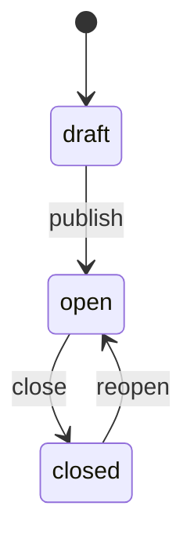
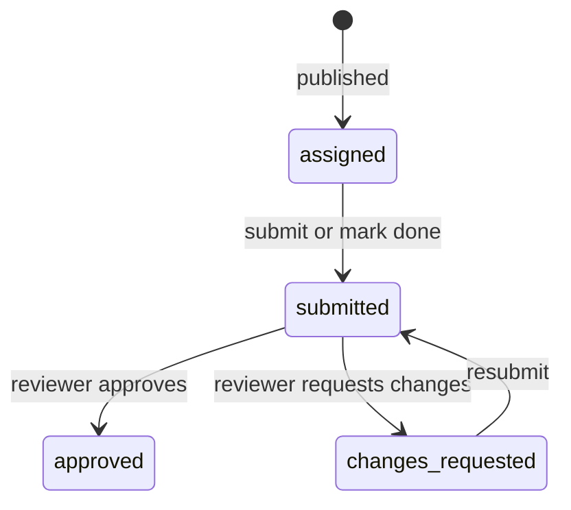

# Feature: Tasks and events (任务与活动)

## Summary

Canvas-style task assignment inside the organization, plus events that need helpers. 主席团 and 部长 create a **task** (任务) with a description, files and an optional due date, or an **event** (活动) such as 春晚 with a time and place. They assign it to people in a chat. Publishing posts a card in that chat and notifies the assignees. Assignees submit text, files or a link, or just mark it done; the creator approves or asks for changes. There are no scores or grades.

Reminders are in-app and push notifications, plus the daily email digest (see [notifications-and-email.md](notifications-and-email.md#daily-digest)).

Code and URLs keep the name `assignments`; the UI says 任务 / Tasks.

## Tasks and events

| | Task (任务) | Event (活动) |
| --- | --- | --- |
| Time | Optional due date and time | Start time (required), optional end time |
| Place | None | Optional location |
| Assignees | People who do the work | Helpers (参与人员) |
| Assignees' part | Submit (text, files, link), or mark done | Nothing to submit; they see it in 任务 and the digest |
| Done when | Approved (or marked done, if auto-approve is on) | The event has ended |

- An event can have prep tasks (筹备任务): ordinary tasks linked to it with `eventId`, for example "海报设计" for 春晚. The event page lists them with progress, and "添加筹备任务" starts a new task with the same chat filled in.
- Times are entered and shown in Pacific time (`America/Los_Angeles`).

## Who can create, and for whom

A task always belongs to one chat: 全体, a department chat, or a group chat. That chat decides who can create it, who can be assigned, where the card is posted, and which file space holds its files.

| Chat | Who can create | Who can be assigned | File space |
| --- | --- | --- | --- |
| 全体 | 主席团 | Anyone approved | 公共 |
| A department chat | That department's 部长, and 主席团 | That department's members | That department |
| A group chat | 部长 of an involved department, and 主席团 in the group | The group's members | One involved department, picked by the creator (default: the first one they lead) |

- 部员 can't create tasks.
- "Everyone in this chat" expands to individual people when the task is published. People who join later aren't added automatically, but the creator can add them.

Full matrix: [02-roles-and-permissions.md](../02-roles-and-permissions.md#tasks-and-events).

## Lifecycle

### Task or event (creator controlled)



- `draft`: only the creator sees it. Drafts can be deleted.
- `open`: assignees see it and can submit.
- `closed`: no new submissions; reviews and comments still work. Open tasks can't be deleted, only closed. That keeps the history.

### Assignee progress (one row per assignee)



- With "需要提交 / Requires submission" off, the assignee only clicks "标记完成 / Mark done". With "自动通过 / Auto-approve" on, marking done goes straight to `approved`.
- Submitting after the due date is allowed and flagged "逾期提交 / Late".
- Event helpers stay `assigned`; the event counts as done for them once it ends (the end time, or the end of the start day if there is no end time).

## Creating (`/assignments/new/?c=<channelId>`)

Opened from "发布任务 / New task" in a chat's composer menu (shown only to people who may create there), or from the 任务 page with a chat picker.

| Field | Required | Notes |
| --- | --- | --- |
| Type | Yes | 任务 or 活动 |
| Title | Yes | Max 120 characters |
| Description | No | Markdown. Type `@` to mention someone in the chat (stored as `<@userId>`) |
| Assignees | Yes | Pick people, or "整个聊天 / Everyone in this chat" |
| Due date and time | No | Tasks only |
| Start, end, location | Start required | Events only |
| Requires submission | Default on | Tasks only |
| Auto-approve | Default off | Only when submission isn't required |
| Part of event | No | Tasks only; an open event in the same chat |
| Files | No | Uploaded into the task's folder (see [Files](#files)) |

Buttons: "保存草稿 / Save draft" and "发布 / Publish".

Publishing:
- Creates one `assignmentSubmissions` row per assignee.
- Posts the card in the chat.
- Sends `assignment_new` notifications (in-app and push).
- Sends `task_mention` to people @mentioned in the description who can see the chat, except those just assigned (they already get `assignment_new`). Editing an open task's description notifies only newly mentioned people.

## Chat card

Publishing posts a message with `kind: "task"` and `assignmentId`, authored by the creator.

- The card shows a 任务 or 活动 badge, the title, the due date (or the time and place), and the number of assignees.
- The creator and reviewers also see progress, for example "5 / 8 已完成".
- An assignee sees their own status chip, and a "标记完成" button when no submission is needed.
- "查看 / Open" goes to the task page. The card stays live: status changes, closing and edits show up without a new message.
- When chat retention removes the message, only the card goes; the task stays.

## Views

### 任务 home (`/assignments/`)

- **我的 Mine:**
  - Events coming up in the next 7 days at the top.
  - Then tasks grouped as 已逾期 Overdue, 今天 Today, 本周 This week, 以后 Later, and 无截止日期 No due date.
  - 已完成 Done is collapsed.
  - Each row shows the title, chat, due date (relative, e.g. "明天 18:00") and status.
- **我发布的 Created by me** (部长 and 主席团): each task with progress and how many are waiting for review. Drafts are listed here.
- **管理 Manage** (部长 and 主席团): every task in the chats they could create in. This includes co-leads' tasks, so either 部长 can review.

On phones the bottom bar's 任务 tab opens this page; 部长 and 主席团 switch tabs with the top switcher bar.

### Task page (`/assignments/view/?a=<id>`)

- **Everyone in the chat:** title, description, files, time and place, and who is assigned with their status. Submissions and comments aren't shown.
- **Assignees:** also their submission form (text, files, link), status, and the comment thread with the reviewers.
- **Creator and reviewers:** a table of assignees with status, submitted time and a late flag. Opening a row shows the submission, Approve and Request changes buttons, and the comment thread. For events: the helper list and the prep tasks.

## Review

- Reviewers are the creator, the 部长 of the departments that could create in the task's chat, and 主席团.
- Approve sets `status = "approved"`, `reviewedBy` and `reviewedAt`, and notifies the assignee (`submission_reviewed`).
- Request changes requires a comment, sets `changes_requested`, and notifies the assignee.
- Comments (`assignmentComments`) form a thread on each submission. The assignee and the reviewers can comment at any time, and each comment notifies the other side (`assignment_comment`).

## Files

- Task files (from the creator) and submitted files go into the task's file space, in an automatic folder `任务 Tasks / <title>` created on the first upload and linked by `folders.assignmentId`.
- Everyone who can view that space can see them. Assignees can upload there through the task even if they can't otherwise upload to that space.
- They count against that space's quota; files over 10 MB, or that don't fit, go to Google Drive. See [files.md](files.md#task-files).

## Documents

A task or event can have collaborative documents (文档), like a shared Google Doc: a run of show, meeting notes, a script. The same editor is used for documents in a folder ([files.md](files.md#documents)) and in a chat ([chat.md](chat.md#shared-documents)).

- **Editing:** live, by everyone who has the document open, through the Convex [`@convex-dev/prosemirror-sync`](https://www.convex.dev/components/prosemirror-sync) component and a TipTap editor (`/docs/?d=<id>`). Changes merge between clients and save automatically.
- **Markdown, rendered as you type:** `# ` heading, `- ` list, `1. ` numbered list, `[ ] ` checklist, `> ` quote, `**bold**`, `*italic*`, `` `code` ``, ```` ``` ```` code block, `---` divider. Pasted markdown is rendered too. The editor only has features markdown can express (headings 1 to 3, bold, italic, strikethrough, code, links, lists, checklists, quotes, code blocks, dividers), so every document exports cleanly.
- **Mentions:** typing `@` (or the @ toolbar button) suggests people who can open the document: for a task, the chat's audience, assignees and creator. A mention is stored as the user's id. When the document saves, newly mentioned people who can open it get `doc_mention` (up to 20 per save; the author is skipped). The exported markdown shows "@Name".
- **Export:** "下载 Markdown / Download Markdown" saves a `.md` file; "导出 PDF / Export PDF" prints just the document in black on white (choose "Save as PDF").
- **Who:** anyone who can see the task can read its documents. Reviewers and assignees (or event helpers) can create and edit them until the task is closed, when they become read-only. The author or a reviewer can delete one. On a draft, only the creator.
- Up to 20 documents per task (`LIMITS.documentsPerTask`); the component supports documents up to about 1 MB.
- Deleting a draft deletes its documents. Content lives in the component's tables; the `documents` table holds the title, the task and who edited last.
- The task description is markdown too and is rendered the same way on the task page, with @mentions as gold chips.

## Reminders

An hourly cron (`internal.assignments.sendReminders`) sends in-app and push notifications only. Email is the daily digest.

| Reminder | When | Who | Sent once per row via |
| --- | --- | --- | --- |
| `assignment_due_soon` | 24 hours before the due date | Assignees not yet submitted or approved | `dueSoonReminderSentAt` |
| `assignment_overdue` | After the due date passes | The same | `overdueReminderSentAt` |
| `event_soon` | 24 hours before an event starts | Helpers | `dueSoonReminderSentAt` |

Changing an open task's due date, or an event's time or place, notifies the assignees (`assignment_updated`) and clears the reminder flags, so the reminders fire again for the new time.

## Convex functions

| Function | Type |
| --- | --- |
| `assignments.listMine`, `listCreatedByMe`, `listManaged` | query |
| `assignments.get` | query (shape depends on the viewer's role) |
| `assignments.listForChannel` | query (cards and the chat's task list) |
| `assignments.canCreate` | query (chats the viewer can create in, with allowed assignees) |
| `assignments.create`, `update`, `publish`, `close`, `reopen`, `remove` (drafts only) | mutation |
| `assignments.addAssignees`, `removeAssignee` | mutation |
| `assignments.submit`, `markDone`, `review` | mutation |
| `assignments.listComments`, `addComment` | query, mutation |
| `internal.assignments.sendReminders` | internal mutation (hourly cron) |
| `documents.listForTask`, `listForChat`, `get` | query |
| `documents.create`, `createInChat`, `createInFolder`, `rename`, `remove` | mutation |
| `prosemirror.getSnapshot`, `latestVersion`, `getSteps`, `submitSteps`, `submitSnapshot` | sync API for `useTiptapSync`; reads and writes are checked against the document's task, chat or folder |

## Acceptance criteria

- [ ] A 部长 can create tasks only in their department's chat and in groups that include their department, and can only assign people in that chat.
- [ ] 主席团 can create a task in 全体 and assign anyone.
- [ ] Publishing posts a card in the chat, and the assignees get a notification and a push.
- [ ] Publishing to "everyone in this chat" creates one row per current member.
- [ ] Members only see tasks that are assigned to them or posted in their chats; only the assignee and reviewers see a submission.
- [ ] Late submissions are flagged. Request changes requires a comment and notifies the assignee.
- [ ] Due-soon, overdue and event reminders are sent at most once per row, and again after the time changes.
- [ ] An event shows its helpers, time and place, and its prep tasks with progress.
- [ ] Submitted files appear in the task's folder in the department's file space.
