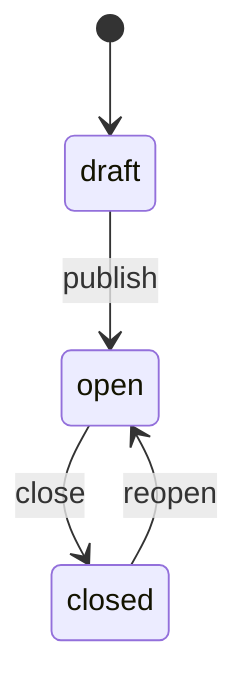
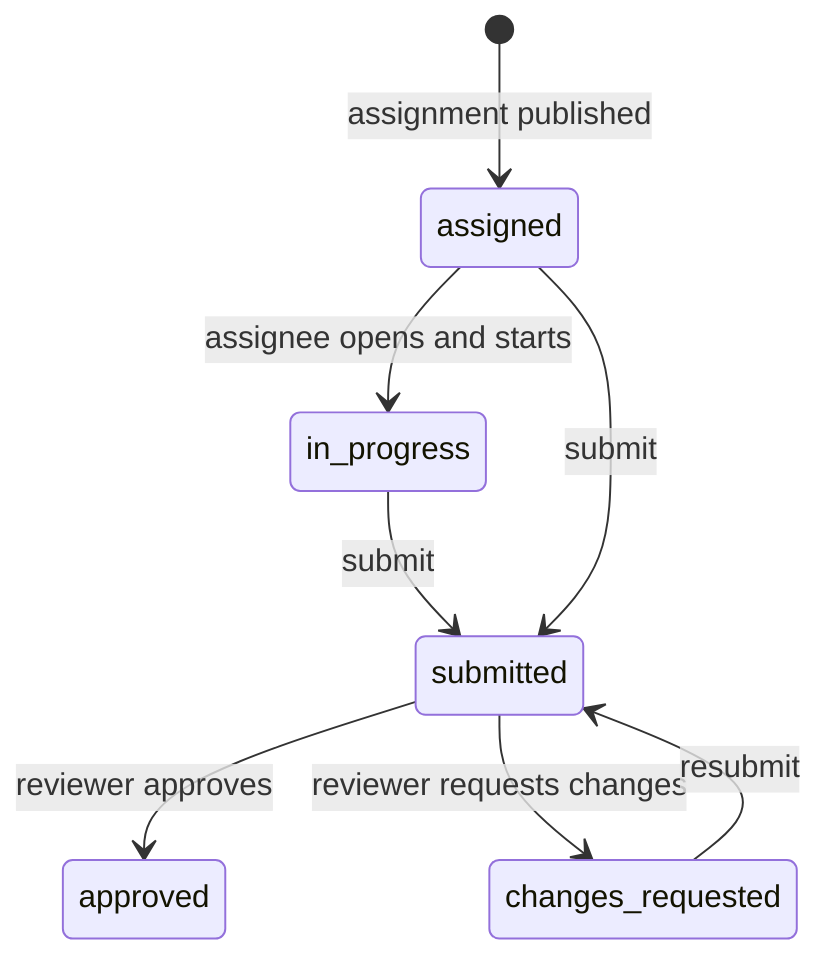

# Feature: Assignments (任务)

## Summary

Canvas-style task assignment inside the organization. Leads and presidium create assignments with a description, attachments, and a due date, then assign them to people or whole departments. Assignees submit text, files, or a link. The creator reviews each submission and approves it or requests changes. Reminders go out by email before the due date.

## Who can do what

- **Presidium**: assign to anyone.
- **Lead**: assign to members of departments they lead (and to their co-leads in those departments).
- **Member**: receives assignments and submits work. Cannot create assignments.

Full matrix: [02-roles-and-permissions.md](../02-roles-and-permissions.md#assignments).

## Lifecycle

### Assignment (creator controlled)

- `draft`: visible only to the creator (and presidium). No submissions exist yet.
- `open`: assignees can see it and submit.
- `closed`: no new submissions; existing data is kept. Reviews are still allowed.

### Submission (one per assignee)

- If `requiresSubmission = false`, the assignee only clicks "标记完成 / Mark done", which moves the status to `submitted` with no content. The creator can enable auto-approve for these.
- Submitting after `dueAt` is allowed but marked "逾期提交 / Late".

## Creating an assignment (`/assignments/new`)

| Field | Required | Notes |
| --- | --- | --- |
| Title | Yes | Max 120 characters |
| Description | Yes | Markdown editor with preview |
| Department | Yes for leads | Which department this is for; limits assignee choices |
| Assignees | Yes | Pick people, or "整个部门 / Whole department" (expands to its members at publish time) |
| Due date and time | No | Shown and stored in `America/Los_Angeles` |
| Requires submission | Yes (default on) | Off = "mark done" task |
| Attachments | No | Same upload flow and limits as Files |

Buttons: "保存草稿 / Save draft" and "发布 / Publish". Publishing creates one `assignmentSubmissions` row per assignee, sends `assignment_new` notifications, and queues emails.

## Views

### Assignments home (`/assignments`)

Tabs:

- **我的任务 Assigned to me**: grouped as Overdue, Due soon (next 7 days), Upcoming, No due date, Completed. Each row shows title, department tag, due date (relative, e.g. "明天 18:00"), and status chip.
- **我发布的 Assigned by me** (leads and presidium): each assignment with progress like "5 / 8 已提交" and the number waiting for review.
- **部门 Department** (leads and presidium): all assignments for the departments they lead, including those created by co-leads.

### Assignment detail (`/assignments/[id]`)

- For assignees: description, attachments, due date, their submission form (text, files, link), status, and the feedback thread.
- For the creator and reviewers: a table of assignees with status, submitted time, late flag; clicking a row opens that submission with Approve and Request changes buttons and the comment thread.
- Overseers viewing a member's submission they are not reviewing see it read-only; that access is logged.

## Review

- Approve: `status = "approved"`, sets `reviewedBy` and `reviewedAt`, notifies the assignee (`submission_reviewed`).
- Request changes: requires a comment; `status = "changes_requested"`; notifies the assignee in-app and by email.
- Comments (`assignmentComments`) form a simple thread on each submission. Both sides can comment at any time.

## Reminders

Handled by an hourly cron in `convex/crons.ts`:

| Reminder | When | Condition | Channel |
| --- | --- | --- | --- |
| Due soon | 24 hours before `dueAt` | Status is `assigned`, `in_progress`, or `changes_requested`, and `dueSoonReminderSentAt` is unset | In-app + email |
| Overdue | Once, after `dueAt` passes | Same statuses, `overdueReminderSentAt` unset | In-app + email to assignee; daily summary to creator |

Emails respect `users.emailPrefs.assignments`. Use `dedupeKey` (e.g. `due_soon:<submissionId>`) so retries never send twice.

## Convex functions

| Function | Type |
| --- | --- |
| `assignments.listAssignedToMe` | query |
| `assignments.listCreatedByMe` | query |
| `assignments.listForDepartment` | query |
| `assignments.get` | query (returns role-specific shape) |
| `assignments.create`, `update`, `publish`, `close`, `reopen`, `remove` (draft only) | mutation |
| `assignments.addAssignees`, `removeAssignee` | mutation |
| `submissions.start`, `submit`, `markDone` | mutation |
| `submissions.review` | mutation (`approve` or `request_changes`) |
| `submissions.recordOversightView` | mutation (audit) |
| `assignmentComments.list`, `add` | query, mutation |
| `internal.assignments.sendDueReminders` | internal mutation (cron) |

## Acceptance criteria

- [ ] A lead cannot assign to users outside departments they lead.
- [ ] Publishing to a whole department creates one submission row per current member.
- [ ] Members only see open assignments assigned to them.
- [ ] Late submissions are flagged.
- [ ] Due-soon and overdue reminders are sent at most once per submission.
- [ ] Request changes requires a comment and notifies the assignee.
